# 功能流程概要

本文从用户角度整理已实现的功能，涵盖功能列表、功能关系、用户与权限，以及各项功能的使用流程。
正式契约由 `概要设计书.md`、`详细设计书_通用.md` 和各详细设计书定义。如有冲突，以正式设计为准。

## 1. 用户与权限

### 1.1 用户

| 用户 | 角色 | 主要使用功能 |
|---|---|---|
| 开发者 | 评审差异并评价发现 | 代码审查、规则应用诊断、登记反馈 |
| SCM 审查人员 | 在 GitHub 上以显式命令回复 AI 评论 | GitHub 反馈回复 |
| 维护人员 | 管理知识与评估质量 | 记忆审批与治理、发布正确答案数据、评估、人工裁定 |
| 管理员 | 管理项目、配置与运行 | 项目管理、备份验证、LLM 和遥测配置 |
| CI | 根据变更自动运行评审 | 代码审查、GitHub 变更请求评审 |
| LLM（AI 网关） | 生成结构化评审、自检和记忆候选 | 外部参与者 |

### 1.2 权限

以 `--actor` 指定操作者。登记反馈以外的下列操作，要求操作者列入 `memory.maintainers`，
并且环境配置为 `memory.is_production: false`。

| 权限 | 相关命令 | 允许的操作者 |
|---|---|---|
| `record-feedback` | 通过 `feedback finding`、`feedback missed-issue`、`scm sync-feedback` 登记 | 所有持有操作者 ID 的用户 |
| `approve-memory` | `memory approve`、`memory reject` | 维护人员 |
| `govern-memory` | `memory archive`、`restore`、`supersede`、`conflict resolve` | 维护人员 |
| `revalidate-memory` | `memory revalidation confirm`、`invalidate` | 维护人员 |
| `publish-ground-truth` | `ground-truth publish` | 维护人员 |
| `adjudicate-evaluation` | `adjudication resolve` | 维护人员 |
| `manage-project` | `governance project register`、`bind-repository`、`adopt-existing` | 维护人员（管理员） |
| `verify-backup` | `governance backup verify` | 维护人员（管理员） |

通过 `scm.feedback_actor_mapping` 将每位 SCM 用户唯一映射到内部操作者 ID。系统只处理已登记用户的回复。

## 2. 功能列表

| ID | 功能 | CLI | 概要 |
|---|---|---|---|
| F01 | 代码审查 | `review review` | 用 LLM 评审 Git 差异，保存并输出经确定性验证的发现 |
| F02 | 规则应用诊断 | `review rules check` | 无需调用 LLM 即可检查各文件命中的规则、预算和发送许可 |
| F03 | 登记反馈 | `review feedback finding`／`missed-issue` | 保存对发现的评价或补报漏检问题 |
| F04 | 提取记忆候选 | （由 F03／F11 自动执行） | 使用 LLM 从反馈生成可复用的知识候选 |
| F05 | 核对与审批记忆 | `review memory list`／`show`／`approve`／`reject` | 人工核对候选，启用或驳回 |
| F06 | 记忆治理 | `review memory archive`／`restore`／`supersede`／`conflict`／`revalidation` | 归档、恢复、替换、解决冲突，复核有效记忆的期限 |
| F07 | 应用记忆的评审 | `review review --mode memory` | 将已审批的记忆注入评审，并固定使用的版本 |
| F08 | 发布正确答案数据 | `review ground-truth publish` | 将人工验证并审批的问题集合发布为不可变版本 |
| F09 | 质量评估 | `review eval` | 重复运行 A／B／C 比较组，与正确答案数据核对后比较 |
| F10 | 人工裁定 | `review adjudication export`／`resolve`／`report` | 对无法自动匹配的发现进行盲化并由人工裁定，得出最终判定 |
| F11 | GitHub 变更请求评审 | `review scm review` | 用 F01 评审 PR，生成演练计划或显式发帖 |
| F12 | GitHub 反馈同步 | `review scm sync-feedback` | 将对 AI 评论的显式回复导入为 F03 反馈 |
| F13 | 项目管理 | `review governance project` | 注册项目、绑定仓库和迁移现有资源 |
| F14 | 备份验证 | `review governance backup verify` | 以只读方式检查恢复后的 SQLite 的一致性 |

F01 包含以下内部功能：

| 内部功能 | 配置 | 内容 |
|---|---|---|
| 敏感信息检查 | 始终启用 | 向 LLM 或 SCM 发送前检查差异、工具输出和评论正文，检出时阻断 |
| 关联文件的审查单元划分 | 始终启用（M3 配置启用后使用增强划分） | 将测试与实现、接口与实现等归入同一单元 |
| 风险分派 | 始终启用 | 根据变更内容确定风险和审查人员类型 |
| 上下文获取工具 | `review.context_tools_enabled` | 应 LLM 请求，在预算内获取文件、符号与代码 |
| 自检 | `review.reflection_enabled` | 核查候选发现的反证 |
| 并行执行 | `review.max_workers` | 在上限内并行处理审查单元，输出顺序独立于完成顺序 |
| 中断恢复 | 始终启用 | 通过幂等键复用同一输入的运行，仅重跑未完成单元 |
| 专项审查人员 | `governance.specialized_reviewers_enabled` | 只为高风险变更最多追加一位 SECURITY／DATA／TEST 审查人员 |
| 执行租约 | `governance.execution_leases_enabled` | 防止同一运行并发启动，拒绝旧所有者保存 |
| 遥测 | `telemetry.enabled` | 仅将允许的属性发送到 OpenTelemetry |

## 3. 功能关系

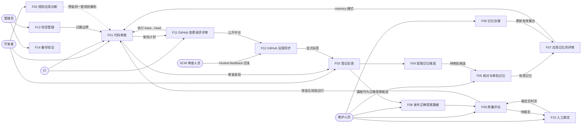

自我改进的主要循环如下。

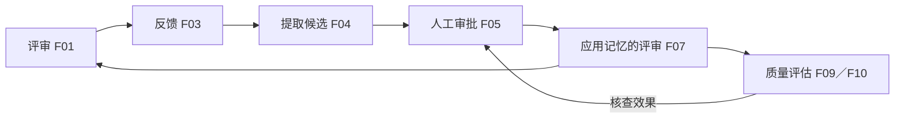

- 评审只使用人工审批的有效记忆版本。
- 评估测试划分上的评审反馈禁止用于提取记忆候选。

## 4. 按用户区分的使用场景

### 4.1 开发者

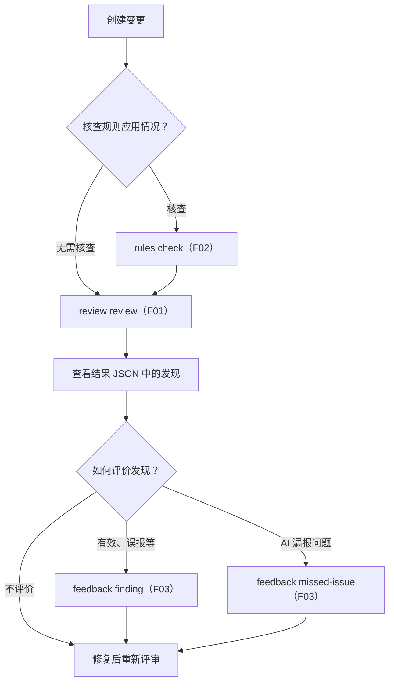

### 4.2 维护人员

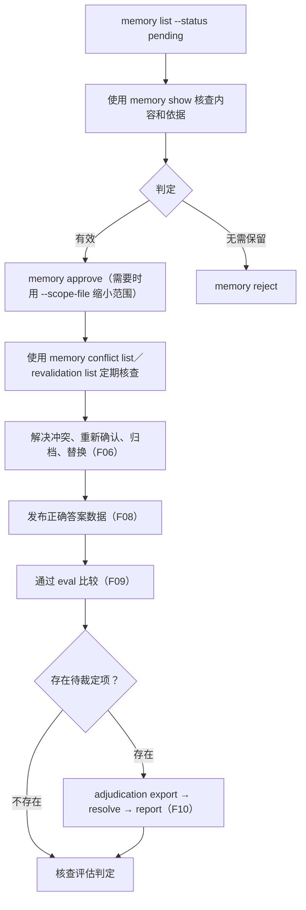

### 4.3 管理员

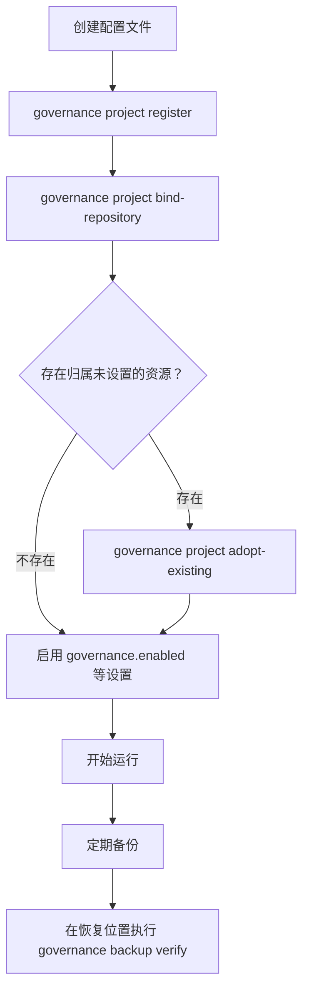

### 4.4 CI 和 SCM 审查人员

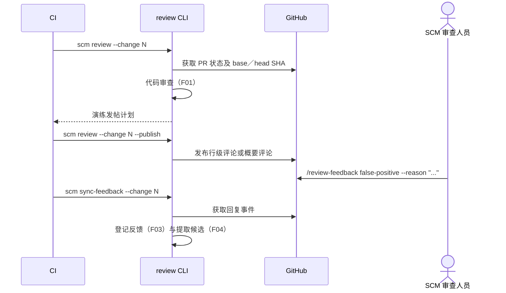

## 5. 各功能详细流程

### 5.1 F01 代码审查

用户为开发者、CI。

```bash
uv run --frozen review review --repository . --config review.yaml \
  [--mode baseline|rules|memory] [--output result.json] \
  (--git-diff | --range BASE HEAD | --commit SHA | --diff-file PATCH)
```

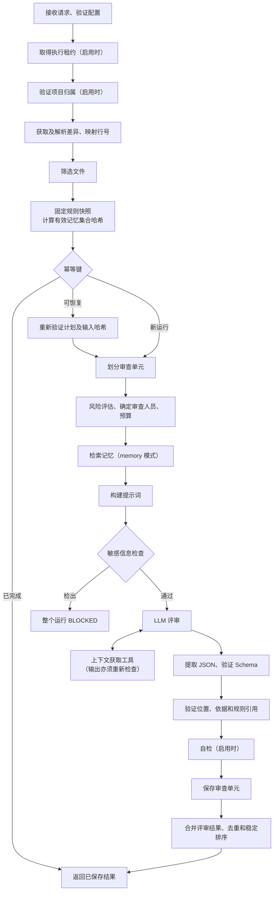

| 步骤 | 确定性处理／LLM | 失败时 |
|---|---|---|
| 获取并解析差异 | 确定性 | 输入非法（退出码 1） |
| 文件筛选 | 确定性，排除二进制、生成物、锁文件和第三方目录等 | 输出排除原因 |
| 敏感信息检查 | 确定性（detect-secrets） | 整体 `BLOCKED`（退出码 4） |
| LLM 评审 | LLM | 仅对临时故障执行有上限的重试，格式错误修复 1 次 |
| 位置和证据验证 | 确定性 | 将相应发现移出主列表并写入度量值 |
| 上下文不足 | 确定性判定 | 输出参考发现 `NEEDS_CONTEXT`，不依据猜测输出发现 |
| 部分单元失败 | ― | `partial-success`（退出码 6） |

输出包括主要发现、参考发现、排除文件、使用的规则和记忆、Token、延迟、费用，
以及运行元数据（模型、提示词版本、快照 ID）。

### 5.2 F02 规则应用诊断

用户为开发者。规则作者可借此核查规则应用情况。

```bash
uv run --frozen review rules check --repository . --config review.yaml \
  [--file PATH] [--output rule-check.json] <差异输入源>
```

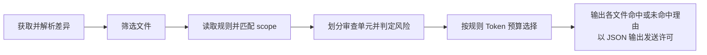

- 复用 F01 的规则解析，因此诊断与实际评审的发送内容一致。
- 此流程只输出诊断结果，禁止调用 LLM、写入数据库或输出敏感信息候选字符串。
- 命中但因预算未发送的规则显示 `RULE_TOKEN_BUDGET_EXCEEDED`。

### 5.3 F03 登记反馈／F04 提取记忆候选

用户为开发者，通过 F12 时为 SCM 审查人员。

```bash
uv run --frozen review feedback finding --run RUN_ID --finding FINDING_ID \
  --label true-positive|false-positive|needs-more-evidence|not-applicable \
  --reason TEXT --actor ACTOR_ID

uv run --frozen review feedback missed-issue --run RUN_ID --file PATH \
  (--start-line N | --symbol NAME) --issue-type TYPE --severity SEVERITY \
  --description TEXT --evidence TEXT --actor ACTOR_ID
```

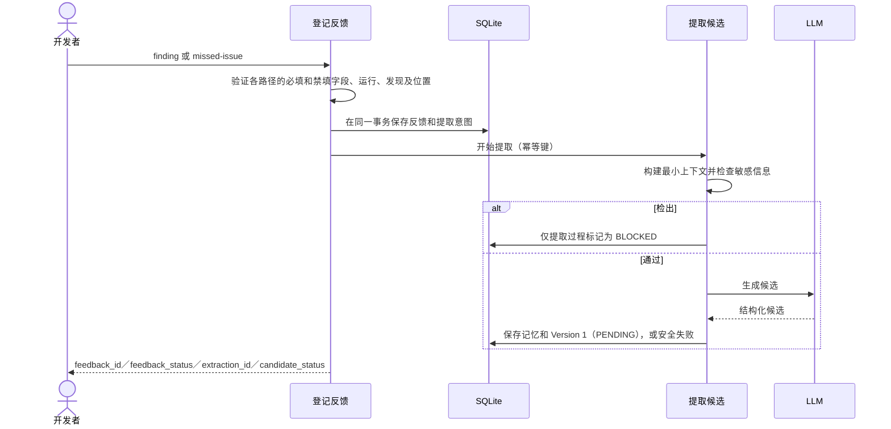

- 提取失败或被阻断时，仍保留已保存的反馈。
- 重跑相同输入时从现有提取状态恢复。
- `missed-issue` 可作为正确答案数据候选，须另行审批才能进入已审批数据。

### 5.4 F05 核对与审批记忆

用户为维护人员（`approve-memory`）。

```bash
uv run --frozen review memory list --status pending
uv run --frozen review memory show MEMORY_ID
uv run --frozen review memory approve MEMORY_ID --actor ID --reason TEXT \
  --lock-version N [--scope-file scope.yaml]
uv run --frozen review memory reject MEMORY_ID --actor ID --reason TEXT --lock-version N
```

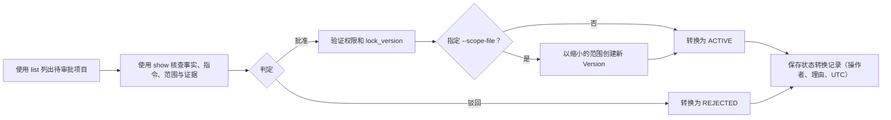

- `lock_version` 乐观锁使并发的两次审批只能成功一次。
- 与有效记忆冲突的候选进入 `CONFLICT`，通过 F06 解决。

### 5.5 F06 记忆治理

用户为维护人员（`govern-memory`、`revalidate-memory`）。须设置 `governance.memory_lifecycle_enabled: true`。

| 操作 | 命令 | 结果 |
|---|---|---|
| 归档 | `memory archive ID --lock-version N --actor --reason` | 转为 `ARCHIVED`，从后续检索排除并保留历史 |
| 恢复 | `memory restore ID ...` | 创建为 `PENDING` 的新 Version，须重新审批 |
| 替换 | `memory supersede ID --replacement NEW_ID ...` | 旧记忆转为 `SUPERSEDED` |
| 冲突列表 | `memory conflict list [--status open]` | 显示待解决冲突 |
| 解决冲突 | `memory conflict resolve CID --resolution R --evidence ...` | `narrow-scope`／`supersede-left`／`supersede-right`／`reject-candidate` |
| 再验证列表 | `memory revalidation list` | 显示达到期限（`due`）的版本 |
| 重新确认 | `memory revalidation confirm ID --evidence ...` | 创建并启用下一 Version |
| 使失效 | `memory revalidation invalidate ID --evidence ...` | 从检索目标中排除 |

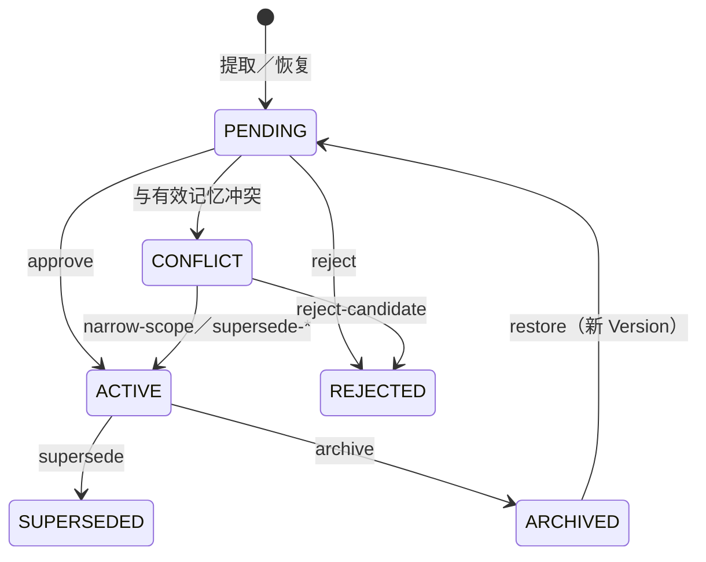

内容变更始终创建新 Version，现有 Version 不可覆盖。

### 5.6 F07 应用记忆的评审

用户为开发者、CI。须设置 `review.mode: memory` 和 `memory.is_injection_enabled: true`。

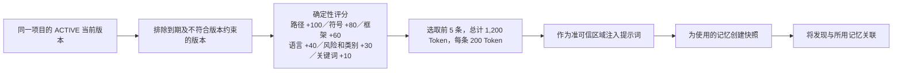

- 记忆禁止直接覆盖行、证据或严重程度。结果必须通过 F01 的验证。
- 有效记忆变化后，即使差异相同也创建新的审查运行。

### 5.7 F08 发布正确答案数据

用户为维护人员（`publish-ground-truth`）。

```bash
uv run --frozen review ground-truth publish --input ground-truth.json --actor ID
```

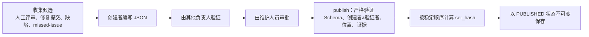

- 已发布的划分和版本不可覆盖。通过发布新版本订正。
- 正式评估的总体样本至少包含 20 个变更、30 个问题，其中至少 5 个严重问题分布在至少 3 个变更中。

### 5.8 F09 质量评估

用户为维护人员。

```bash
uv run --frozen review eval --arms A,B,C --split test --set-version N --repeat 3
```

| 比较组 | 内容 |
|---|---|
| A | 无规则或记忆 |
| B | 只有规则 |
| C | 在与 B 相同的规则上加入固定记忆 |

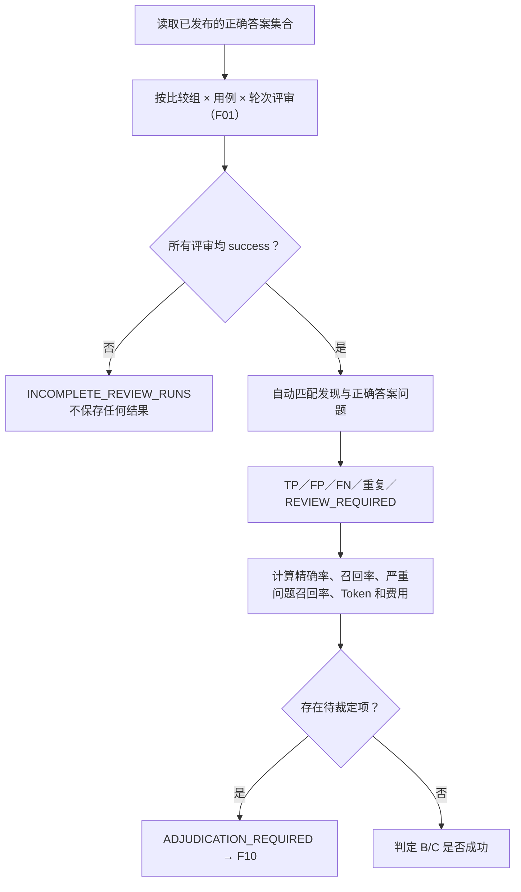

- 所有比较组使用相同的模型、提示词、规则快照和用例顺序。
- 判定严重问题保留情况时，要求 C 的每一轮涵盖 B 所有轮次检出的严重问题 ID 并集。

### 5.9 F10 人工裁定

用户为维护人员（`adjudicate-evaluation`）。

```bash
uv run --frozen review adjudication export --split test --set-version N --output blind.json
uv run --frozen review adjudication resolve --token TOKEN \
  --result true-positive|false-positive|duplicate [--issue-id ID] --actor ID --reason TEXT
uv run --frozen review adjudication report --split test --set-version N
```

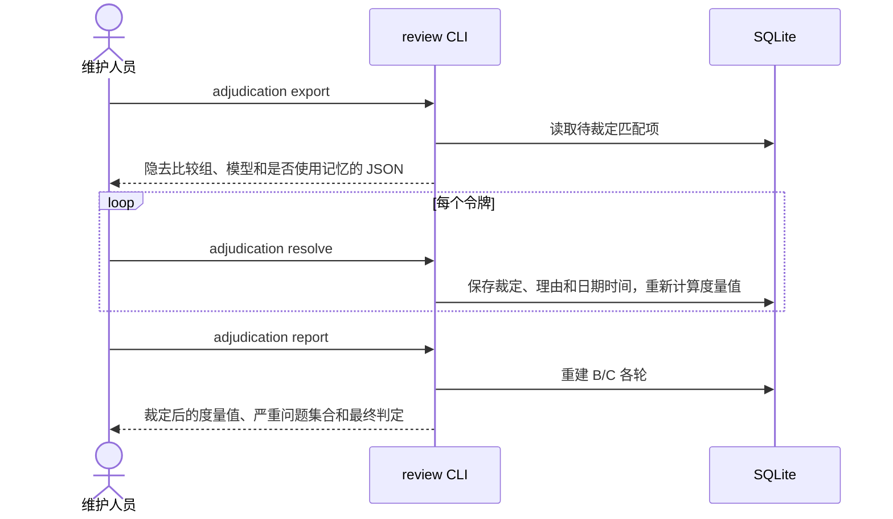

- `true-positive` 和 `duplicate` 必须指定正确答案问题 ID，`false-positive` 禁止指定。
- 存在待裁定项、重复轮次不足或严重问题检出退化时，退出码为 2。

### 5.10 F11 GitHub 变更请求评审

用户为 CI、开发者。令牌只能通过环境变量 `REVIEW_SCM_TOKEN` 提供。

```bash
uv run --frozen review scm review --change 123 [--mode MODE] [--output JSON] [--publish]
```

发帖须同时通过以下三道门禁：

1. 设置 `scm.enabled: true` 且 `scm.publish_enabled: true`。
2. CLI 显式指定 `--publish`。
3. 运行时头提交 SHA 和 PR 状态与计划生成时一致。

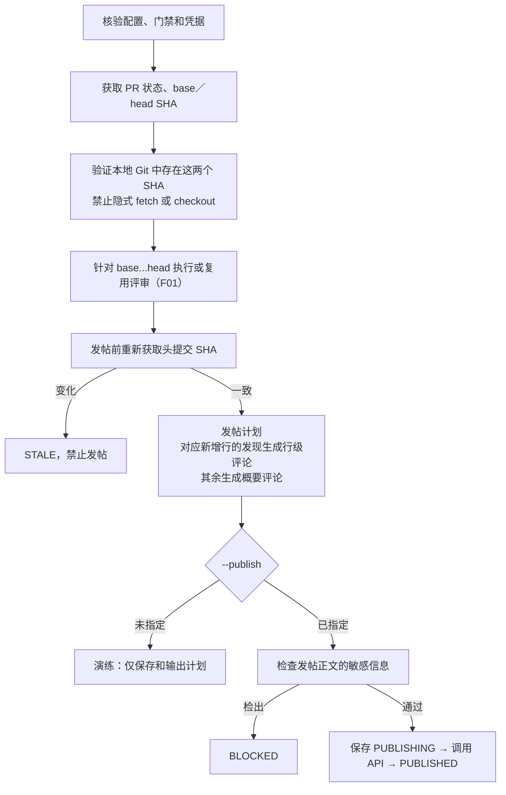

- 同一运行重新发帖时复用或更新原有评论，禁止重复创建。
- 超出行级评论上限的发现移入概要，继续保留。

### 5.11 F12 GitHub 反馈同步

SCM 审查人员回复，CI 或开发者执行同步。
须设置 `scm.feedback_sync_enabled: true` 和 `scm.feedback_actor_mapping`。

已发布行级评论的回复格式：

```text
/review-feedback true-positive --reason "..."
/review-feedback false-positive --reason "..."
/review-feedback needs-more-evidence --reason "..."
/review-feedback not-applicable --reason "..."
```

```bash
uv run --frozen review scm sync-feedback --change 123 [--output JSON]
```

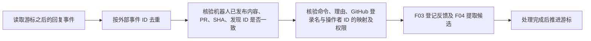

只有符合格式的回复可生成反馈。普通回复、表情、未知标签、无理由回复，以及映射表中没有的用户均不符合条件。

### 5.12 F13 项目管理

用户为管理员（`manage-project`）。

```bash
uv run --frozen review governance project list
uv run --frozen review governance project register --project ID --name NAME --actor ID --reason TEXT
uv run --frozen review governance project bind-repository --project ID --provider github \
  --external-repository owner/repo --actor ID --reason TEXT
uv run --frozen review governance project adopt-existing --project ID \
  --resource-type ground-truth-set|scm-change --resource-id ID --actor ID --reason TEXT
```

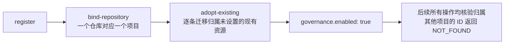

### 5.13 F14 备份验证

用户为管理员（`verify-backup`）。

```bash
uv run --frozen review governance backup verify --database restored.db \
  --project ID --actor ID --output verification.json
```

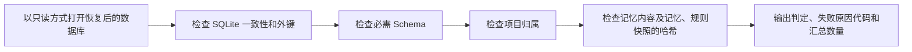

目标数据库保持只读，禁止初始化、迁移或更新。有效时退出码为 0，一致性或授权失败时为 5。

## 6. 退出码

| 代码 | 含义 |
|---:|---|
| 0 | 成功 |
| 1 | 非法输入 |
| 2 | LLM 调用失败、评估未完成或存在待裁定项 |
| 3 | 非法 LLM 输出 |
| 4 | 策略或敏感信息检查阻断 |
| 5 | 内部错误、并发运行冲突或备份不一致 |
| 6 | 部分成功 |
