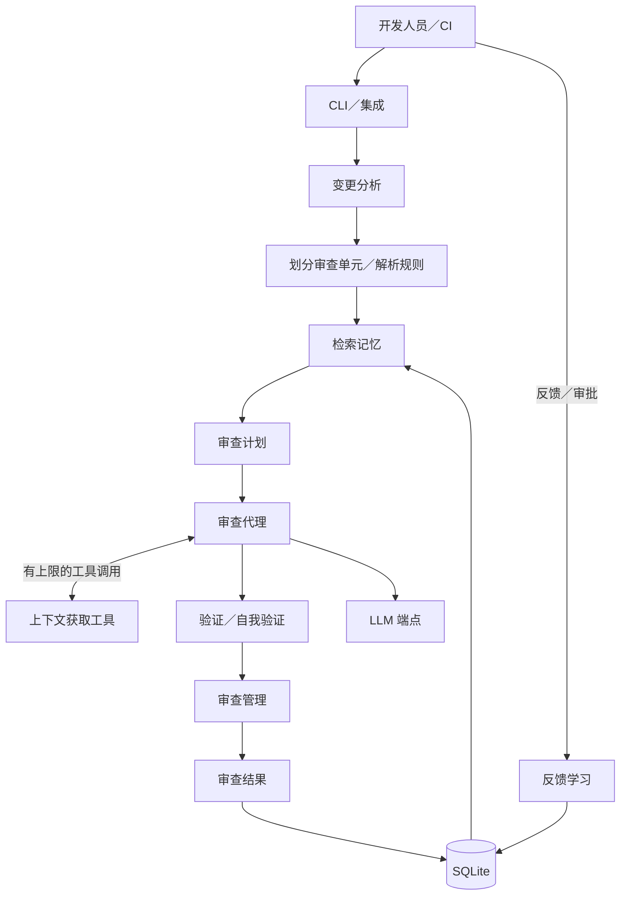
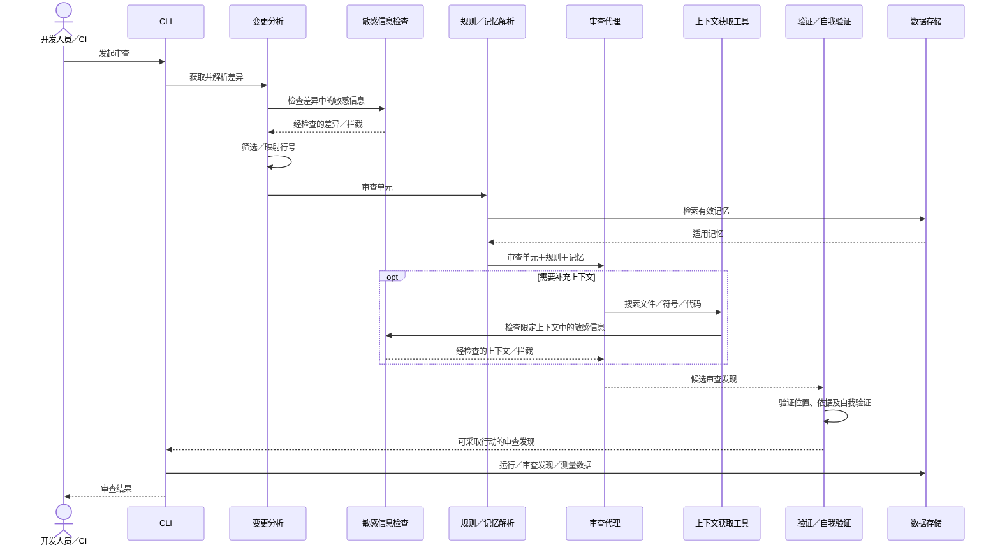
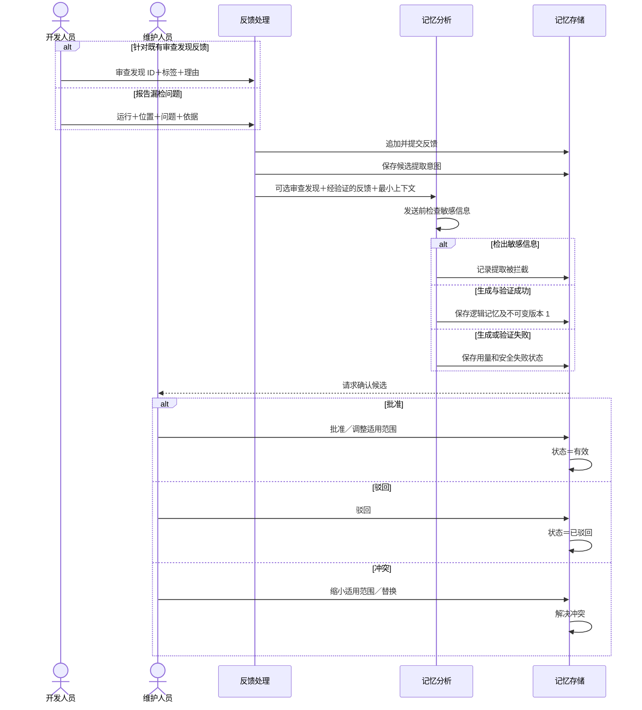
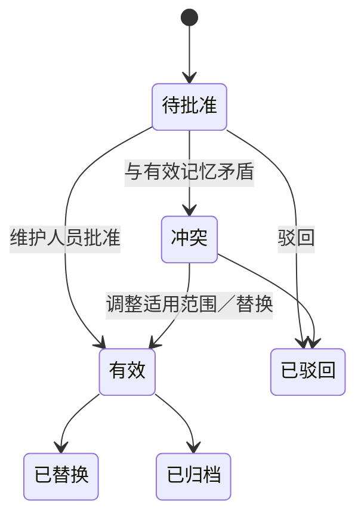
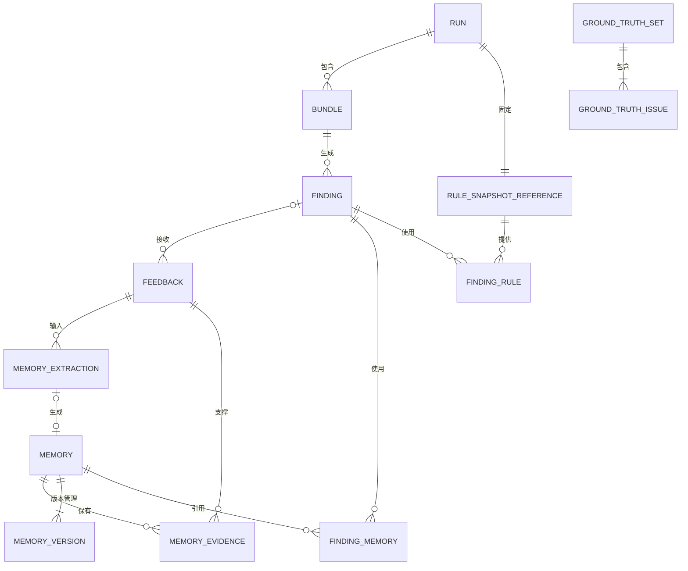

# 自我改进型 AI 代码审查工具概要设计书

## 文档信息

| 项目 | 内容 |
|---|---|
| 文档名称 | 自我改进型 AI 代码审查工具概要设计书 |
| 系统名称 | 自我改进型 AI 代码审查工具 |
| 文档类型 | 概要设计书 |
| 版本 | 1.0 |
| 状态 | 草案 |
| 创建日期 | 2026-09-12 |
| 适用阶段 | MVP（最小可行产品）至实际业务集成 |
| 目标读者 | 开发人员、代码审查人员、运维人员及审查人员 |

### 修订历史

| 版本 | 日期 | 变更内容 | 作者 |
|---|---|---|---|
| 1.0 | 2026-09-12 | 编制初版，将既有构想整理为概要设计书 | 项目团队 |

### 相关文档

| 文档 | 目的 |
|---|---|
| `开发标准.md` | 开发流程、命名、静态检查、测试及 CI 的规范 |
| `详细设计书_通用.md` | 共通契约、阶段划分、模块、端口、安全及运维边界 |
| `详细设计书_M1_审查基础.md` | 差异审查基础设施的详细设计 |
| `详细设计书_M2_反馈记忆.md` | 反馈、记忆与评估的详细设计 |
| `详细设计书_M3_流水线增强.md` | 上下文获取工具、自我验证及恢复的详细设计 |
| `详细设计书_M4_SCM集成.md` | SCM 集成的详细设计 |
| `详细设计书_M5_治理增强.md` | 治理、可扩展性与可观测性的详细设计 |
| 测试计划书（待编制） | 单元、集成和评估的执行方针 |
| 运维设计书（待编制） | 监控、故障处理、备份及维护步骤 |

---

# 1. 引言

## 1.1 目的

本文定义自我改进型 AI 代码审查工具的目标、适用范围、系统架构、主要功能、数据、外部接口、非功能需求及运维方针。

本系统是以 Git 差异或拉取请求为输入的 AI 代理。它自主解析变更、筛选审查对象、检索相关规则与项目专有知识、按需获取代码上下文、检测候选问题、验证依据与位置并去重，生成可采取行动的代码审查结果。

系统还将开发人员的反馈提炼成可复用的技术知识记忆，经过人工批准后用于后续审查，从而减少重复误报，并持续适应项目的具体情况。

## 1.2 背景

常见的 AI 代码审查存在以下问题。

- 无法理解项目特有的设计方针和框架保证。
- 反复产生相同或相似的误报。
- 在大型拉取请求中可能漏掉部分文件。
- 只从差异无法判断调用关系和相关实现。
- 评论位置偏离实际的变更行。
- 推测性或重复的审查发现较多，增加开发人员的核实成本。
- 多个代理读取相同上下文会推高 Token 成本。
- 开发人员的判断没有用于下一次审查。

## 1.3 系统构想

> **优先提高审查发现的有效率，并通过经过验证的开发人员反馈持续积累项目专有技术知识的 AI 代码审查代理。**

本系统由两套机制组成。

1. **确定性审查处理基础设施**：通过确定性逻辑保证文件筛选、规则适用、行号定位、依据验证及成本控制。
2. **反馈与记忆循环**：将开发人员的判断转为可审计、可撤回的项目知识，供后续审查使用。

## 1.4 作为 AI 代理的定位

系统不局限于一问一答。接收用户的审查目标后，系统，分析环境、确定执行计划、选择并调用工具、验证结果，直至完成任务。

| AI 代理要素 | 在本系统中的实现 |
|---|---|
| 目标 | 完成拉取请求或 Git 差异的代码审查 |
| 环境感知 | 分析差异、文件类型、风险、规则和记忆 |
| 执行计划 | 确定文件的审查单元及审查角色策略 |
| 工具使用 | 读取文件、查找符号、搜索代码 |
| 动态判断 | 根据风险和上下文缺口执行补充处理 |
| 验证 | 验证位置、依据与模式，并执行自我验证 |
| 记忆 | 经批准的技术知识记忆 |
| 执行结果 | 可定位到具体行、可采取行动的审查发现 |

---

# 2. 范围

## 2.1 业务范围

本系统支持软件开发中的以下业务。

- 预审查本地工作差异
- 审查分支或提交之间的差异
- 自动审查拉取请求
- 收集开发人员对审查发现的反馈
- 从反馈生成记忆候选
- 由维护人员批准或驳回记忆
- 使用已批准的记忆执行后续审查
- 评估审查质量、Token、等待时间和费用

## 2.2 MVP（最小可行产品）的范围

MVP 实现以下功能。

| ID | 功能 |
|---|---|
| MVP-01 | 获取及解析 Git 差异 |
| MVP-02 | 标注绝对行号并识别可评论的行 |
| MVP-03 | 筛选目标文件并创建简单审查单元 |
| MVP-04 | 匹配项目规则的适用范围 |
| MVP-05 | 由通用审查代理生成候选审查发现 |
| MVP-06 | 生成结构化审查发现、指纹和依据 |
| MVP-07 | 验证位置、依据和模式 |
| MVP-08 | 登记人工反馈 |
| MVP-09 | 生成、批准及驳回记忆候选 |
| MVP-10 | 检索有效记忆并注入上下文 |
| MVP-11 | 保存审查会话和成本测量数据 |
| MVP-12 | 通过 B/C 比较组评估记忆效果 |

## 2.3 范围之外

以下事项不纳入 MVP。

- 启动多个审查角色的固定多代理结构
- 向量数据库和嵌入检索
- 增量训练
- 自动批准记忆
- 对创建者可信度连续评分
- 基于 GitHub / GitLab Webhook 的全自动集成
- 验收数据审批 Web 界面及其草稿、审批与发布流程
- Kubernetes
- 多模型自动分流
- 持续发送整个仓库

## 2.4 后续扩展

- 按风险选用专项审查角色
- GitLab / Gerrit 实际适配器与 Webhook 自动启动
- 查看审查会话
- 记忆冲突、失效和替换管理
- 混合检索
- 基于 OpenTelemetry 的可观测性
- 本地部署的 LLM 集成
- 检查完整文件

---

# 3. 前提与约束

## 3.1 前提条件

| 项目 | 前提 |
|---|---|
| 运行环境 | Python 3.14.x |
| 仓库 | 由 Git 管理 |
| Git | 能获取差异 |
| LLM | 通过 `https://aigw.ldjp-ai.link` 上兼容 OpenAI 的 AI 网关，使用固定的模型别名 |
| 持久化 | MVP 使用 SQLite |
| 操作形式 | MVP 使用 CLI |
| 记忆 | 审查仅使用经人工批准的 `active` 记忆 |

## 3.2 约束

- 上下文窗口和 API 费用均有上限。
- LLM 输出具有非确定性，即使模型和采样设置相同，也无法保证输出完全一致。
- 某些问题无法仅根据差异作出判断。
- 将源代码发送到外部必须遵守组织策略。
- 本系统只能部分替代人工代码审查、静态分析和测试。
- 禁止仅凭记忆隐藏重大安全审查发现。

## 3.3 设计原则

- 能确定性处理的环节由程序逻辑保证。
- LLM 仅用于代码语义分析、上下文选择及反馈提炼。
- 优先考虑精确率，同时设定召回率的安全基线。
- 根据风险选择审查角色。
- 学习结果须可解释、可审计、可撤回。
- 以显式状态返回失败。

---

# 4. 使用者与使用场景

## 4.1 参与者

| 参与者 | 职责 |
|---|---|
| 开发人员 | 运行审查、核实审查发现、登记反馈 |
| 维护人员 | 批准、驳回记忆候选或调整其适用范围 |
| 审查人员 | 核实 AI 审查发现及修复内容 |
| 管理员 | 管理 LLM、费用、安全需求及配置和运维设置 |
| CI 系统 | 根据拉取请求触发审查并集成结果 |
| LLM 提供商 | 生成结构化审查结果及记忆候选 |

## 4.2 主要用例

| ID | 用例 | 主要参与者 | 结果 |
|---|---|---|---|
| UC-01 | 审查本地差异 | 开发人员 | 获取结构化审查发现 |
| UC-02 | 审查分支或提交 | 开发人员 | 获取目标范围内的审查发现 |
| UC-03 | 评价审查发现 | 开发人员 | 保存与审查发现关联的反馈 |
| UC-03A | 新报 AI 漏检的问题 | 开发人员 | 保存不关联已有审查发现的 `MISSED_ISSUE` 反馈 |
| UC-04 | 确认记忆候选 | 维护人员 | 候选成为有效或已驳回状态 |
| UC-05 | 使用记忆重新审查 | 开发人员 | 获取反映项目上下文的审查发现 |
| UC-06 | 评估审查质量 | 维护人员 | 比较精确率、召回率和费用 |
| UC-07 | 检出敏感信息时停止运行 | 系统 | 在对外发送前安全拦截 |

---

# 5. 功能概要

## 5.1 功能列表

| 功能 ID | 功能名称 | 概要 | MVP |
|---|---|---|---|
| FN-01 | 获取差异 | 从工作树、分支、提交及差异文件获取变更 | ○ |
| FN-02 | 变更分析 | 判定文件类型、语言、风险及变更规模 | ○ |
| FN-03 | 敏感信息预检 | 在对外发送前，使用 detect-secrets 引擎检测疑似敏感信息并拦截 | ○ |
| FN-04 | 文件筛选 | 排除二进制文件、生成文件及锁定文件等 | ○ |
| FN-05 | 划分文件审查单元 | 将相关文件归入同一个审查单元 | △ 简化版 |
| FN-06 | 解析规则 | 按语言、路径、风险等条件选择规则 | ○ |
| FN-07 | 记忆检索 | 检索适用范围匹配的有效记忆 | ○ |
| FN-08 | 审查执行计划 | 确定各审查单元的角色及预算 | ○ 基于规则 |
| FN-09 | AI 审查 | LLM 代理生成候选审查发现 | ○ |
| FN-10 | 上下文获取工具 | 在预算内取得必要的输入源或符号 | △ 分阶段引入 |
| FN-11 | 验证 | 验证模式、位置与依据 | ○ |
| FN-12 | 自我验证 | 检查审查发现的反证 | △ 分阶段引入 |
| FN-13 | 审查管理 | 汇总、去重、筛选及排序 | ○ |
| FN-14 | 收集反馈 | 保存对审查发现的评价或新报的 AI 漏检问题 | ○ |
| FN-15 | 提取记忆 | 从反馈生成记忆候选 | ○ |
| FN-16 | 记忆审批 | 批准、驳回候选或标记冲突 | ○ |
| FN-17 | 会话管理 | 保存运行、审查发现、费用和版本 | ○ |
| FN-18 | 评估 | 在比较组间比较质量及费用 | ○ |
| FN-19 | SCM 集成 | 通过 CLI 联动 GitHub 拉取请求评论及反馈 | M4 |

## 5.2 反馈类型

反馈标签的写法及转换以本节为唯一依据。

| 外部接口值 | 内部枚举值 | 含义 |
|---|---|---|
| `useful` | `USEFUL` | 正确、可执行且有用的审查发现 |
| `false-positive` | `FALSE_POSITIVE` | 问题不存在或与项目事实相矛盾 |
| `missing-context` | `MISSING_CONTEXT` | 缺少必要上下文，无法判断 |
| `duplicate` | `DUPLICATE` | 与其他审查发现内容相同 |
| `wrong-severity` | `WRONG_SEVERITY` | 问题正确，但严重程度不适当 |
| `not-actionable` | `NOT_ACTIONABLE` | 内容抽象，无法用于修复 |
| `comment` | `COMMENT` | 补充信息 |
| `missed-issue` | `MISSED_ISSUE` | AI 未检出的问题 |

- CLI 选项、外部 API 与未来 SCM 集成的输入输出使用表中的外部接口值。复合词采用小写短横线格式。
- 应用内部使用 `FeedbackLabel` 的内部枚举值。数据库保存相同的 `UPPER_SNAKE_CASE` 值并以约束验证。
- CLI、API 及 SCM 适配器在边界上仅转换一次，支持双向转换。未定义值、大小写不同及 `false_positive` 等变体按无效输入处理。

`MISSED_ISSUE` 无对应审查发现，所以 `finding_id` 可选。必须填写目标拉取请求或提交、文件、行号或符号、问题内容和依据。登记时是正确答案数据候选，不自动加入已批准的正确答案数据。

---

# 6. 系统架构

## 6.1 整体架构



## 6.2 架构方针

| 分层 | 职责 |
|---|---|
| 确定性处理层 | 差异、文件、适用范围、行号、模式、依据及费用 |
| 代理层 | 语义分析、上下文判断、候选审查发现及自我验证 |
| 知识层 | 规则、反馈、记忆与依据链 |
| 基础设施层 | Git、SQLite、LLM API 和 SCM 集成 |

## 6.3 组件列表

各组件的物理包及目录位置统一以 `开发标准.md` 8.1 节“包与目录结构”为准。

| ID | 组件 | 职责 |
|---|---|---|
| CP-01 | CLI 与集成适配器 | 接收输入、执行命令、返回退出码 |
| CP-02 | 变更分析 | 解析差异、标注行号、判定文件和风险 |
| CP-03 | 敏感信息检查 | 使用 detect-secrets Python API，在每次向 LLM 发送差异或上下文工具输出前检查 |
| CP-04 | 文件筛选 | 排除无需审查的文件 |
| CP-05 | 划分审查单元 | 将相关文件归入同一个审查单元 |
| CP-06 | 解析规则 | 读取及验证仓库规则，将其应用于审查单元并生成规则快照引用 |
| CP-07 | 检索记忆 | 检索相关有效记忆并在预算内选择 |
| CP-08 | 审查计划 | 确定审查角色、工具与 Token 预算 |
| CP-09 | 构建上下文 | 组合差异、规则、记忆及取得的上下文 |
| CP-10 | 审查代理 | 生成候选审查发现 |
| CP-11 | 上下文工具 | 读取文件、查找符号、搜索代码 |
| CP-12 | 验证位置 | 确认文件及行号的一致性 |
| CP-13 | 验证依据 | 确认代码、符号及依据确实存在 |
| CP-14 | 自我验证 | 检查候选的反证及证据充分性 |
| CP-15 | 审查管理 | 汇总、去重、筛选及确定优先级 |
| CP-16 | 反馈处理 | 验证及保存反馈 |
| CP-17 | 记忆分析 | 提炼记忆候选 |
| CP-18 | 记忆治理 | 审批、冲突处理、替换及归档 |
| CP-19 | 运行评估 | 执行比较组、计算测量数据并比较 |
| CP-20 | LiteLLM 适配器 | 调用 AI 网关、超时、重试、异常转换及用量管理 |

---

# 7. 主要处理流程

<a id="71-コードレビュー実行フロー"></a>

## 7.1 代码审查执行流程



从代理启动审查时，可使用[审查技能](../.agents/skills/self-improving-code-review/SKILL.md)。
该技能说明如何调用现有 CLI 及维护提示词资源。审查时发送给 LLM 的指令以
`prompts/` 中进行版本管理的 YAML 为准，由 CLI 构造请求。

## 7.2 反馈与记忆应用流程



## 7.3 敏感信息检测流程

1. 对来源于输入源的数据，在每次 LLM 调用前检查敏感信息，包括首次发送的审查单元差异及后续上下文获取工具的输出。
2. 在将工具输出传给上下文构建流程或 LLM 客户端之前进行检查。检查涵盖 `read_file` / `get_changed_file` 的文件正文及 `find_symbol` / `search_code` 返回的所有代码片段。
3. 在调用工具前先判定是否为禁止访问的路径，作为第一道防线。常规路径的输入源仍须进行基于内容的敏感信息检查。
4. 检出疑似敏感信息时，不将工具输出置入提示词、缓存、日志或持久化存储，也不向 LLM 发送。停止整个审查，包括已开始的审查单元，标记为 `Policy / Secret Scan Blocked`。
5. 本地结果只显示并记录检测来源（`diff` / `context_tool`）、工具名、文件和行号，不保存敏感字符串或对应代码片段。
6. 只有显式临时覆盖策略时才允许重新执行。首次差异及各次上下文工具输出的检查对覆盖设置采用同一策略。

记忆候选提取独立于审查运行。若提取候选的发送单元检出敏感信息，保留已保存的反馈，仅将当次提取设为
`BLOCKED`，不得生成候选或对外发送。若在审查差异或审查过程获取的上下文中检出敏感信息，仍按契约拦截整个审查。

检测引擎使用 `detect-secrets 1.5.0`，与 pre-commit 仓库门禁共用版本、检测插件和阈值。FN-03 在进程内调用 Python API，
使用严格配置，不应用 `.secrets.baseline` 的现有结果、目标输入源内的允许列表注释以及按路径设置的抑制项。
仓库门禁与 FN-03 的职责、配置和契约测试统一以 `开发标准.md` 16.4 节为准。

## 7.4 异常处理流程

| 事件 | 处理 |
|---|---|
| 输入无效 | 不执行，返回相关项目及理由 |
| 检出敏感信息 | 对外发送前拦截 |
| LLM 超时 | 有上限重试后，将审查单元记为失败 |
| LLM 模式无效 | 重新解析或只请求一次修复，失败时报告错误 |
| 上下文获取工具禁用或缺少所需上下文 | 不调用工具，标为 `needs_context`，转入参考或人工审查，不生成推测性审查发现 |
| 工具预算超限 | 工具启用时标为 `needs_context`，转入参考或人工审查，不生成推测性审查发现 |
| 位置无效 | 从主要列表排除该审查发现，记入测量数据 |
| 依据无效 | 从主要列表排除该审查发现，记入测量数据 |
| 审查部分失败 | 继续其他审查单元，将运行记为部分成功。按 12.3 节返回退出码 6，并输出失败单元的 ID 与理由 |
| 数据库失败 | 保持保存一致性，无成功结果 |

---

# 8. 审查设计概要

## 8.1 文件筛选

下列文件默认排除在审查之外，或仅做轻量审查。

- 二进制文件
- 生成文件
- 依赖锁定文件
- 外部依赖或构建产物
- 大型压缩文件
- 匹配显式排除模式的文件

在运行元数据中记录排除结果与理由。

## 8.2 划分文件审查单元

将以下相关文件归入同一审查单元。

- 实现及对应的测试
- API 模式及处理
- 模型及迁移
- 接口及实现
- 同一功能的资源文件

审查单元隔离上下文，便于拆分和并行处理大规模差异。

## 8.3 审查分配

| 风险或文件特征 | 审查方针 |
|---|---|
| 常规小规模代码差异 | 通用审查角色 |
| 控制器、API 或认证 | 通用审查加安全规则 |
| SQL、命令或反序列化 | 必须进行安全审查 |
| 实现及测试 | 通用审查加测试规则 |
| 仅测试 | 关注测试和回归 |
| 文档或资源 | 轻量审查或排除 |
| 大规模、高风险 | 拆分审查单元并使用专项审查角色 |

MVP 依据规则分配审查，计划处理本身不使用 LLM。

## 8.4 上下文获取工具

分阶段引入后，预计提供以下工具。

```text
read_file(path, start_line, end_line)
find_symbol(name, path_scope)
search_code(query, path_scope)
get_changed_file(path)
```

标准约束如下。

| 项目 | 初始值 |
|---|---:|
| 最大工具调用次数 | 5 |
| 动态上下文 Token | 6,000 |
| 单次调用最大行数 | 200 |
| 访问根目录 | 仓库根目录 |
| 禁止访问的路径 | `.env`、凭据、敏感信息、私钥 |
| 内容检查 | 每次工具输出加入上下文或发送给 LLM 之前均须检查 |

上下文获取工具按 TBD-04 的决定分阶段引入，MVP 无须提供。禁用工具时，代理仅使用审查单元差异、
规则、记忆等初始上下文。仅凭初始上下文无法确定依据的候选，不尝试调用工具，而是返回 `needs_context`，
转入参考或人工审查。启用工具但无法取得必要上下文或超出工具预算时，也采用相同处理。以上情况均不将推测性结果显示为主要审查发现。

禁止路径是防止访问已知敏感文件的一层防护。通过路径检查的工具输出也必须等待敏感信息检查返回 `passed`，才可加入动态上下文。

## 8.5 审查发现判定

显示审查发现的条件如下。

```text
line_valid = true
AND evidence_valid = true
AND reflection_status IN (supported, reflection_skipped)
```

禁用 FN-12 自我验证时，`reflection_status` 的默认值为 `reflection_skipped`。
该状态仅在 MVP 的显示判定中与 `supported` 同等处理，未表示检查过反证。
启用自我验证时，根据反证检查结果设为 `supported` 或 `contradicted`，不得在未执行时设置 `reflection_skipped`。

| 状态 | 显示 |
|---|---|
| `supported` | 主要审查发现 |
| `reflection_skipped` | 主要审查发现（禁用自我验证时的默认值） |
| `needs_context` | 参考或人工审查 |
| `contradicted` | 隐藏，只记录测量数据 |
| `duplicate` | 隐藏，合并到原审查发现 |
| 位置或依据无效 | 隐藏，记入质量测量数据 |

---

# 9. 规则与记忆设计概要

## 9.1 项目规则

规则采用结构化形式，并具有适用范围。

```yaml
id: SPRING.CONTROLLER.VALIDATION
category: validation
severity: medium
scope:
  languages: [java]
  paths:
    - "src/**/controller/**"
  keywords:
    - "@Valid"
instruction: >
  对于带有 @Valid 的参数，通常无需重复验证。
  有证据表明存在绕过验证的路径或缺失的约束时，需要相应验证。
```

规则必填项为 `id`、`category`、`severity`、`scope`、`instruction`。`severity` 取
`critical` / `high` / `medium` / `low` 之一，与审查发现严重程度使用相同枚举。
`scope` 是包含 `languages`、`paths`、`keywords` 数组的对象，至少一个数组有值。
未使用的数组可省略，未知字段触发模式错误。

规则 ID 发布后不得更改语义，须用正例和反例验证。`GENERAL` 命名空间预留给不依赖项目规则的审查发现确定性 ID，项目规则不得使用。

仓库中的 YAML 是规则的唯一可信来源（SoT），标准位置为 `config/rules/**/*.yaml`。
新增、修改及删除规则均经过拉取请求审查，并在 Git 中进行版本管理。
禁止在数据库中直接创建或更新规则正文。

| 对象 | 管理位置 | 版本或标识符 | 用途 |
|---|---|---|---|
| 规则定义 | 仓库内的 YAML | Git 提交 SHA + 规则文件路径 + 内容哈希 | 唯一可信来源 |
| 规则快照引用 | 数据库 | `rule_snapshot_id` + 规则集哈希 | 运行复现、审计及关联审查发现 |

运行开始时，规则解析流程读取目标 Git 修订的 YAML，并验证模式、规则 ID 重复及引用完整性。
经验证的规则集以快照引用保存到数据库，包含 Git 提交 SHA、各规则的 ID、文件路径、内容哈希和规则集哈希。
运行固定引用该 `rule_snapshot_id`。数据库不另存权威规则正文，须从记录的 Git 修订还原内容。
YAML 与快照引用不一致时禁止开始运行。

允许规则数为 0 或 `config/rules` 不存在，这仍是有效配置。这时也须创建规则快照引用，以空规则列表计算规则集哈希。
将空规则集状态记入运行，在评估中按等同于 A 组的无规则贡献条件处理。
因此即使规则集为空，每次运行也恰好有一条规则快照引用。

读取或验证规则集失败时禁止开始运行。模式错误、规则 ID 重复、引用不一致及 YAML 与快照引用不匹配
均判为 `Invalid Input`（退出码 1）。空规则集可正常使用。

## 9.2 技术知识记忆

记忆保存经过验证的项目技术知识。

主要字段如下。

| 项目 | 内容 |
|---|---|
| ID | 记忆的唯一标识符 |
| 项目 | 适用的目标项目 |
| 分类 | 框架、架构、验证等 |
| 适用范围 | 语言、框架、路径、符号及关键词 |
| 规则 | 项目中的事实 |
| 审查指令 | 审查时的判定指引 |
| 极性 | `suppress` / `emphasize` |
| 依据 | 原反馈及审查发现 |
| 置信度 | 分析用置信度 |
| 状态 | `pending` / `active` / `conflict` 等 |

`suppress` 要求提供更强的依据，禁止无条件隐藏。`emphasize` 根据历史漏检和故障标识重点核查对象。

## 9.3 记忆生命周期



审查只使用 `active` 记忆。

## 9.4 记忆检索

MVP 不使用向量数据库，按以下条件检索。

```text
项目／语言／框架／路径 glob
分类／风险标签／关键词／变更符号
```

优先级如下。

```text
完全匹配的路径／符号
> 框架／语言
> 风险／分类
> 关键词
> 置信度／最近确认
```

对记忆适用范围的已指定条件，组间取逻辑与，组内取逻辑或。
仅在同一文件满足全部条件时纳入注入对象，禁止组合不同文件的匹配。
候选匹配多个文件时，使用最高匹配分数。

初始预算如下。

| 项目 | 初始值 |
|---|---:|
| 前 K 条 | 5 |
| 记忆 Token 预算 | 1,200 |
| 单条记忆的最大 Token 数 | 200 |

---

# 10. 数据设计概要

## 10.1 主要实体

| 实体 | 说明 |
|---|---|
| 运行 | 一次审查运行及复现信息 |
| 审查单元 | 将相关文件归在一起的审查单位 |
| 审查发现 | AI 生成且通过验证的候选审查发现 |
| 反馈 | 开发人员的审查发现评价或漏检报告 |
| 记忆提取运行 | 跟踪保存反馈后的候选提取意图、状态、提示词及模型、用量和失败的运行记录 |
| 记忆 | 项目专有知识的逻辑 ID、当前版本及状态 |
| 记忆版本 | 由 `(memory_id, version)` 固定的不可变内容，包括适用范围、事实及审查指令等 |
| 记忆依据 | 记忆与原始反馈的关联 |
| 审查发现记忆 | 审查发现与使用的记忆之间的关联 |
| 规则快照引用 | 固定仓库规则集版本以复现运行的引用。规则正文仍以仓库为准。即使规则为 0，也必须创建一条空集合引用 |
| 审查发现规则 | 审查发现与适用规则 ID 的关联 |
| 正确答案数据集 | 按开发与测试分开进行版本管理的正确答案集合 |
| 正确答案问题 | 正确答案数据集中已批准的问题 |

## 10.2 ER 概要



按 9.1 节，即使没有规则也会创建空集合的快照引用，因此
`RUN ||--|| RULE_SNAPSHOT_REFERENCE` 是必需的一对一关系。审查发现不依赖规则时，`FINDING_RULE` 数量为 0。

## 10.3 审查发现概要

| 项目 | 说明 |
|---|---|
| `id` | 运行内 ID |
| `file` | 相对于仓库根目录的路径 |
| `start_line` / `end_line` | 新文件中的绝对行号 |
| `category` / `issue_type` | 审查发现分类 |
| `rule_id` | 标准问题 ID |
| `primary_entity` | 问题涉及的主要符号 |
| `severity` | `critical` / `high` / `medium` / `low` |
| `title` / `description` | 概要及详情 |
| `evidence` | 代码与判定依据 |
| `suggestion` | 可实施的修复办法 |
| `fingerprint` | 跨审查保持稳定的标识符 |
| `used_rule_ids` | 运行固定的规则快照引用中实际使用的规则 ID |
| `used_memory_ids` | 使用的记忆 |
| 验证状态 | 位置、依据和自我验证的状态 |

## 10.4 稳定指纹

使用确定性逻辑生成指纹。

```text
fingerprint = rule_id : normalized_path : enclosing_symbol : primary_entity
```

不依赖项目规则的审查发现，其 `rule_id` 使用 `GENERAL.<NORMALIZED_ISSUE_TYPE>`。
依赖项目规则的审查发现只能引用实际发送给目标文件的规则。

示例如下。

```text
JAVA.NULL_DEREFERENCE:src/UserService.java:handleUser:user
SECURITY.SQL_INJECTION:src/UserDao.java:search:query
```

行号及自然语言标题易于变化，因此不作为指纹的主要元素。

## 10.5 数据保留方针

| 数据 | 是否保存 | 方针 |
|---|---|---|
| 审查发现的结构化字段 | ○ | 用于反馈和评估 |
| 依据代码 | ○ | 只保存最低限度的片段 |
| 反馈与创建者 | ○ | 用于依据链和治理 |
| 规则快照引用 | ○ | 保留 Git 提交 SHA、规则 ID、路径、内容哈希及规则集哈希，不保存规则正文 |
| 记忆 | ○ | 保存版本及状态 |
| 正确答案数据集及问题 | ○ | 保存划分、版本、批准者、依据及原始反馈 |
| 完整差异及输入源 | × | 从提交引用重新获取 |
| 完整提示词 | × | 只记录 Token 数与哈希 |
| 原始 LLM 响应 | 原则上不保存 | 仅在调试且经过脱敏时允许 |
| 疑似敏感信息的字符串 | × | 只记录文件与行 |

---

<a id="11-外部インターフェース概要"></a>

# 11. 外部接口概要

## 11.1 CLI

命令示例：

```bash
review review --diff-file diff.patch --output review.json
review review --git-diff --output review.json

review rules check --git-diff --file src/UserService.py --output rule-check.json
review feedback finding \
  --run RUN-001 \
  --finding R001 \
  --label false-positive \
  --reason "框架保证此值非 null。"

review feedback missed-issue \
  --run RUN-001 \
  --file src/UserService.py \
  --start-line 42 \
  --issue-type null-dereference \
  --severity high \
  --description "引用的值可能为 null。" \
  --evidence "前一个分支可能使该值为 None。"

review memory list --status pending
review memory approve MEM-001
review memory reject MEM-002

review eval --arms B,C --split test --repeat 3
```

M1 实现的 `review review` 接受以下通用选项。

| 参数 | 必填 | 默认值 | 功能 |
|---|---:|---|---|
| `--repository PATH` | 否 | 当前目录 | 指定目标 Git 仓库根目录，以及限定在仓库内的配置路径基准。 |
| `--project PROJECT_ID` | 否 | 配置值 | 覆盖 `project_id`。 |
| `--config YAML` | 否 | 内置值和环境变量 | 读取 YAML 配置。相对路径以进程当前目录为基准。 |
| `--mode MODE` | 否 | 配置值 | `baseline` 不加规则，`rules` 添加规则，`memory` 是为 M2 保留的值。M1 的 `memory` 不注入记忆。 |
| `--output JSON` | 否 | 标准输出 | 指定结果 JSON 路径。指定时原子保存。 |
| `-h` / `--help` | 否 | — | 显示用法、简体中文命令和参数说明。 |

M1 的规则诊断接口如下。

| 命令 | 功能 |
|---|---|
| `review rules check <差异输入>` | 无需调用 LLM，以 JSON 返回差异中每个目标文件的规则命中或未命中原因、风险、规则 Token 预算以及是否可发送提示词。 |
| `--file PATH` | 仅诊断差异中的指定文件。路径不在差异中时按无效输入处理。 |

差异输入、`--repository`、`--config` 和 `--output` 沿用 `review review` 的契约。
诊断复用正式审查的规则读取、Scope 匹配、审查单元拆分、风险判定和 Token 预算选择。
已命中规则因预算未发送时，返回 `RULE_TOKEN_BUDGET_EXCEEDED`。诊断不会向外部发送数据、写入数据库或输出疑似敏感字符串。

必须且只能选择以下四种差异输入之一。混用视为无效输入。

| 差异输入 | 功能 |
|---|---|
| `--git-diff` | 通过 `git diff` 获取工作树相对于索引的未暂存差异。 |
| `--range BASE HEAD` | 将引用解析为提交，获取 `BASE...HEAD` 的三点比较差异。 |
| `--commit SHA` | 通过 `git show` 取得指定单一提交引入的差异。 |
| `--diff-file PATCH` | 读取最大 20 MiB 的 UTF-8 补丁。相对路径以进程当前目录为基准。 |

反馈输入分为两条路径，禁止混用。

| CLI 路径 | 用途 | 必填输入 | 禁止输入 |
|---|---|---|---|
| `feedback finding` | 评价已有问题 | `--run`、`--finding`、`--label`、`--reason` | `--label missed-issue` |
| `feedback missed-issue` | 报告 AI 漏检的问题 | `--run`、`--file`、`--issue-type`、`--severity`、`--description`、`--evidence`、`--start-line` 或 `--symbol` | `--finding`、`--label` |

`feedback finding --label` 接受第 5.2 节定义的外部接口值，排除 `missed-issue`。
`feedback missed-issue` 内部设置 `MISSED_ISSUE`，根据 `--run` 引用的拉取请求或提交和报告位置建立独立反馈。
`--start-line` 与 `--symbol` 至少指定一项，同时指定时必须验证两者指向同一处。
违反对应路径必填或禁止条件时，按无效输入处理并拒绝保存。

反馈先持久化，记忆候选提取作为独立运行状态跟踪。CLI 分别返回
`feedback_id`、`feedback_status`、`extraction_id` 和 `candidate_status`。
候选提取失败或因检出敏感信息而被拦截时，已保存反馈仍然有效。
同一输入重跑时通过提取幂等键恢复已有状态。

## 11.2 LLM 接口

| 项目 | 内容 |
|---|---|
| 协议 | HTTPS |
| API 格式 | OpenAI 兼容 |
| 客户端库 | 生产使用 LiteLLM Python SDK。开发与测试使用不接入网络的固定数据集适配器 |
| 调用 | `litellm.completion` |
| 基础 URL | 配置值为 `https://aigw.ldjp-ai.link`。适配器调用时补上 `/v1` |
| 模型指定 | `openai/<model>` |
| 库内重试 | 设置 `num_retries=0`，由应用适配器集中管理重试 |
| 模型 | 网关发布的固定别名。连接验证使用 `gpt-5.6-luna` |
| 后端 | 由网关管理，应用不直接调用专用 API 或 SDK |
| 输入 | 系统指令 + 可信规则 + 有上限的不可信数据 |
| 输出 | 符合 JSON 模式的结构化结果 |
| 认证 | 从环境变量或密钥存储取得 AI 网关凭据 |
| 超时 | 由配置值控制 |
| 重试 | 仅对暂时性故障执行有界重试 |
| 用量 | 记录输入和输出 Token |

## 11.3 Git 接口

通过 Git CLI 获取工作树、分支范围和提交的差异。命令执行集中在专用适配器中，参数显式构造。

## 11.4 SCM 接口（M4）

M4 首版优先支持 GitHub，通过现有 CLI 手动执行以下操作。

- 获取拉取请求外部 ID、base/head SHA 和状态。
- 使用本地 Git 中的固定 SHA 执行已有审查。
- 默认试运行，制定行级和摘要评论计划。
- 仅在满足三重显式门禁时幂等发帖。
- 手动同步使用正式 M2 标签的明确命令。

首版范围不含 Webhook、常驻进程、GitLab 真实适配器，以及从表情或自由形式回复推断反馈。

---

# 12. 输入输出设计概要

## 12.1 审查输入

| 项目 | 必填 | 说明 |
|---|---|---|
| 仓库路径 | 是 | 审查目标仓库 |
| 差异输入 | 是 | 工作树、范围、提交或文件。SCM 使用已验证 base/head SHA 的范围 |
| 项目 ID | 是 | 规则或记忆的隔离单位 |
| 模型配置 | 是 | 供应商与固定模型版本 |
| 审查模式 | 是 | 基准、规则或记忆 |
| 预算配置 | 是 | Token、工具调用数和文件大小限制 |

## 12.2 审查输出

| 项目 | 说明 |
|---|---|
| 问题 | 已验证的行级问题 |
| 参考问题 | 因上下文不足等原因需要人工审查的候选 |
| 所用规则与记忆 | 判断时使用的知识 |
| 被排除文件 | 不在范围内的文件及理由 |
| 指标 | Token、成本、等待时间及验证率 |
| 运行元数据 | 模型、提示词、记忆快照和版本 |

## 12.3 退出代码

| 代码 | 含义 |
|---:|---|
| 0 | 成功 |
| 1 | 无效输入 |
| 2 | LLM 调用失败 |
| 3 | LLM 输出无效 |
| 4 | 策略或敏感信息检查拦截 |
| 5 | 内部错误 |
| 6 | 部分成功 |

位置或依据无效时，隐藏该问题并记入质量指标，运行整体可继续。

第 7.4 节的审查部分失败场景中，若一些单元失败且其余单元完成，返回退出代码 6。
输出成功单元的问题，并明确列出失败单元的 ID 和原因。
若所有单元均失败，按主要失败原因返回 2、3 或 5。

---

# 13. 非功能要求

## 13.1 性能与成本

| ID | 要求 |
|---|---|
| NF-P01 | 调用 LLM 前完成文件筛选及规则和记忆适用范围匹配 |
| NF-P02 | 按风险选择审查者，避免固定多智能体 |
| NF-P03 | 为审查单元、规则、记忆和动态上下文设定 Token 上限 |
| NF-P04 | 支持按审查单元并行 |
| NF-P05 | 按运行记录输入和输出 Token、等待时间及成本 |
| NF-P06 | 可计算每个有效问题的成本 |

初始上下文预算：

| 类别 | Token 上限 |
|---|---:|
| 审查单元差异 | 8,000 |
| 规则 | 1,500 |
| 记忆 | 1,200 |
| 动态上下文 | 6,000 |
| 自我验证 | 2,000 |

## 13.2 可用性与可靠性

- 单个审查单元失败时，其余单元应能继续。
- 明确表示部分成功。
- 区分 LLM、Git 和数据库故障。
- 仅为暂时性基础设施错误重试。
- 可从运行元数据重现运行条件。
- 使用保证一致性的事务更新数据库。

## 13.3 可维护性

- 通过适配器分离 Git、数据库和 LLM 供应商。
- 领域模型独立于供应商 SDK。
- 为提示词、规则和模式分配版本。
- 确定性逻辑优先使用可进行单元测试的纯函数。
- 编码遵循 `开发标准.md`。

## 13.4 可观测性

结构化日志记录以下内容。

```text
timestamp / level / event
run_id / bundle_id / finding_id
model / prompt_version / memory_snapshot_id
duration_ms / input_tokens / output_tokens
tool_calls_count / validation_status
```

日志禁止记录 API 密钥、敏感信息、完整提示词和完整输入。

## 13.5 可移植性

- 考虑 Windows、Linux 和 macOS 上的 CLI 执行。
- 在内部规范化文件路径。
- 可通过 OpenAI 兼容接口替换 LLM。
- 禁止外发源代码的环境可以切换到本地端点。

---

<a id="14-セキュリティ設計概要"></a>

# 14. 安全设计概要

## 14.1 信任边界

| 输入来源 | 信任程度 | 处理方式 |
|---|---|---|
| 系统提示词 | 可信 | 唯一指令来源 |
| 纳入版本管理的项目规则 | 可信 | 通过受控模板注入 |
| 有效记忆 | 半可信 | 验证并审批后注入 |
| 差异或输入源 | 不可信 | 作为审查数据处理 |
| 拉取请求或提交元数据 | 不可信 | 作为数据处理 |
| 自由文本反馈 | 不可信 | 禁止直接写入审查提示词 |

## 14.2 防止提示词注入

- 用显式边界包围不可信数据。
- 转义数据内出现的边界字符串。
- 源代码注释中的文字一律作为数据处理。
- 系统指令和数据分属不同区域。
- 禁止将原始反馈直接保存为有效记忆。
- 记忆候选须通过模式、长度和模式匹配验证以及人工审批。

## 14.3 源代码外部发送

允许发送的内容：

- 当前审查单元的差异。
- 匹配适用范围的规则和有效记忆。
- 智能体通过工具明确请求的最少必要代码。

无论 LLM 目的地是外部供应商还是本地端点，上述源数据均须通过每次发送前的敏感信息检查。
复用上下文工具输出时，也须按发送单元核查检查结果。未检查或检查版本未知时禁止发送。

禁止发送的内容：

- 整个仓库。
- 作者邮箱等非必要个人信息。
- `.env`、凭据、证书、令牌和私钥。
- 工具未请求的源文件。

## 14.4 安全优先规则

SQL 注入、授权问题及敏感信息泄露等严重问题不得仅靠记忆抑制。
记忆可以调整证据要求或检查项，禁止自动隐藏严重问题。

---

# 15. 评估设计概要

## 15.1 目标

验证系统能否维持召回率，同时减少误报与成本。输出数量本身不作为效果判据。

公开质量以固定版本的 AACR-Bench 为主要评测。直接使用其专家复核标签，按上游评分口径报告。
第 15.2～15.7 节的项目内 A/B/C 契约继续适用于既有自建数据集。公开基准结果单独报告。
详见[AACR-Bench 质量评测](AACR-Bench_质量评测.md)。

## 15.2 数据划分

```text
Dev Set  : 用于生成反馈和记忆
Test Set : 仅用于评估，禁止将反馈加入记忆
```

按拉取请求划分，尽可能将同一文件、同一模块及高度相似的用例放在同一侧。

在运行和报告中，另外按用途区分开发调优集、已知缺陷回归集、冻结的独立验收集。
现有 `split` 和持久化模式的取值不变。
根据可见结果调优或订正的用例作为已知回归。更改版本号、负责人名称或重新执行全部比较组，均无法恢复未见性。
保留订正前后的数据集及判定。要提出新的独立验收结论，须使用与调优隔离的资料，并完成独立验证与审批。
区分用途和候选、技术检查、验证、审批、发布等状态。未确认独立性时保持未确认状态。
固定、查看历史和报告流程遵循[评估数据独立性管理](评估数据_独立性管理.md)。

MVP 评估启动的数据集下限：

| 划分 | 拉取请求数量下限 | 附加条件 |
|---|---:|---|
| 开发数据集 | 30 个拉取请求 | 包含反馈和记忆候选的生成来源 |
| 测试数据集 | 20 个拉取请求 | 至少 30 个已批准的正确答案问题 |

为评估严重问题的召回率，测试数据集须至少含 5 个 `critical` 正确答案问题，并分布在至少 3 个拉取请求中。
以 `N_critical` 表示总体数量，并在评估报告中注明数量和问题 ID 列表。
未满足条件时，返回 `insufficient_evaluation_data`，不判定第 15.6 节的成功条件。

## 15.3 正确答案数据

正确答案数据是经过版本管理的一组已批准问题。人员确认这些问题确实存在于目标拉取请求，且应由 AI 检出。
也保留经人工确认无问题的变更作为评估用例，用于测量误报。
排除样式偏好，以及无法根据变更范围合理判断的问题。

每个正确答案问题至少保留以下内容。

| 项目 | 内容 |
|---|---|
| `case_sequence` / `commit_sha` | 评估用例及固定变更引用，涵盖无问题变更 |
| `ground_truth_issue_id` | 可跨版本跟踪的 ID |
| `split` / `pr_id` / `commit_sha` | 开发或测试划分，以及目标变更 |
| `file` / `line_range` / `symbol` | 问题位置，无法用行表示时使用符号 |
| `category` / `issue_type` / `severity` | 可与审查发现匹配的分类 |
| `description` / `evidence` | 问题与判断依据 |
| `source` / `source_feedback_id` | 来源，例如审查、故障、测试或 `MISSED_ISSUE` |
| `status` | `candidate` / `approved` / `rejected` / `retired` |
| `created_by` / `verified_by` / `approved_by` | 创建人、验证人和审批人 |
| `set_version` | 评估固定的正确答案数据集版本 |

创建和维护步骤：

1. 审查者根据人工审查结果、修正提交、测试或故障记录、静态分析或 `MISSED_ISSUE` 反馈创建候选。
2. 独立于创建者的另一位审查者核对目标提交代码及证据，验证问题类型、严重程度、位置及重复情况。
3. 维护人员决定 `approved` 或 `rejected`。有分歧时，维护人员记录依据并裁决。
4. 评估前，发布包含已批准用例和问题的正确答案数据集版本，固定目标拉取请求列表（含无问题用例）、问题列表、提交 SHA 和数据集哈希。
5. 发布后新增、订正或废止内容时，保留已有版本并记录新版本。评估中发生变更时，所有比较组使用同一版本重新执行。

`MISSED_ISSUE` 反馈是正确答案候选的来源，须完成独立核对与审批。
开发集候选获批后，可同时作为正确答案数据和记忆候选的依据。
测试集的 `MISSED_ISSUE` 在评估完成前禁止加入记忆。
批准并更新测试正确答案时递增版本，重新评估全部比较组，保留旧结果。

按同一拉取请求、同一根因、相容的 `issue_type` 或 `rule_id`、以及匹配的位置或符号，
对齐审查发现与正确答案问题。允许表述差异。自动匹配无法判定时，在隐藏比较组的情况下由审查者判定，
维护人员审批。多个审查发现匹配同一正确答案问题时，首个计为真阳性，其余计为重复和误报。

<a id="154-要素別比較"></a>

## 15.4 分要素比较

| 比较组 | 输入上下文 | 验证对象 |
|---|---|---|
| A | 仅差异 | 基础模型能力 |
| B | 差异 + 项目规则 | 静态规则的贡献 |
| C | 差异 + 项目规则 + 反馈记忆 | 记忆的贡献 |

项目的主要主张通过 **C − B** 评估。

## 15.5 评估指标

- 精确率
- 召回率
- 严重问题的召回率
- 误报数
- 开发者接受率
- 重复率
- 行号超出范围率
- 依据无效率
- 输入、输出及动态上下文 Token
- 等待时间
- 每次审查成本
- 每个有效问题成本

比较固定版本的测试正确答案数据集与主要问题来计算指标。
参考问题不计为检出。正确答案问题没有对应的主要问题时，记为漏报。

```text
Precision       = True Positive / (True Positive + False Positive)
Recall          = True Positive / (True Positive + False Negative)
严重问题召回率   = 严重问题真阳性数 / N_critical
Critical Retention (B -> C) = C 检出的 B 已检出严重问题数
                              / B 检出的严重问题数
```

未匹配正确答案的主要问题记为误报，未匹配主要问题的正确答案记为漏报。
分母为 0 时，相应指标记为 `not_evaluable`，不作成功判定。

## 15.6 MVP 成功条件

以在测试数据集上比较组 C 相对 B 同时满足以下条件为目标。

| 指标 | 条件 |
|---|---|
| 误报 | 至少减少 30% |
| 召回率 | 保持在 B 的 95% 以上 |
| 严重问题召回率 | C 不低于 B |
| 严重问题保留率（B → C） | 100%。C 检出 B 已检出的每个严重正确答案问题 |
| 每个有效问题成本 | 不出现无法接受的恶化 |

除汇总值外，须按问题 ID 判定严重问题。C 只要漏检一个 B 已检出的严重问题，即判定违反严重问题保留率要求，
即使 C 新检出其他严重问题且严重问题召回率不低于 B。
如果 B、C 各自均检出 0 个严重问题，即使召回率相同，严重问题保留率也记为 `not_evaluable`，不判为成功。

跨重复执行按 ID 判断。B 任意一次重复检出的严重问题都纳入并集，C 每次重复都必须检出该并集的全部 ID。
禁止因 B 在各次重复间检出不稳定而从保留率总体中移除已检出的严重问题。

即使误报减少，只要召回率或严重问题安全门槛未达标，仍判为失败。

仅当满足第 15.2 节规定的拉取请求、正确答案问题及严重问题数量，并以同一固定测试数据集版本运行所有比较组时，才判定是否成功。

## 15.7 可复现条件

- 固定模型版本。
- 固定提示词、审查者配置及处理基础设施版本。
- 固定规则快照 ID、Git 提交 SHA 和规则集哈希。
- 默认省略 `temperature`，使用模型默认值。比较时固定相同配置。
- 仅在模型支持时显式设置采样值或种子，并在各比较组固定。
- 记录记忆快照。
- 每一比较组和用例组合执行至少 3 次，报告平均值与波动范围。

---

# 16. 运行设计概要

## 16.1 配置管理

| 配置 | 管理策略 |
|---|---|
| AI 网关 | 基础 URL 为 `https://aigw.ldjp-ai.link`。应用仅调用此网关 |
| LLM 客户端库 | LiteLLM Python SDK。允许版本范围由 `pyproject.toml` 管理，解析后的版本由 `uv.lock` 管理 |
| API 密钥 | 从环境或密钥存储获取 AI 网关凭据 |
| 模型 | 固定网关公布的具体模型 ID 或版本，禁止 `latest` 等可变别名 |
| 提示词 | 在仓库中进行版本管理 |
| 项目规则 | 仓库的 `config/rules/**/*.yaml` 是唯一权威来源，并由 Git 管理版本。数据库仅保存运行所用规则快照的引用 |
| 记忆 | 数据库管理状态、版本和依据 |
| 预算 | 按项目或环境配置 |
| 排除路径 | 使用受版本管理的策略 |

## 16.2 备份与恢复

- 定期备份 SQLite 数据库。
- 支持恢复记忆、反馈和依据链。
- 从 Git 恢复源代码和完整差异。
- 按仓库版本恢复提示词和规则。
- 执行模式迁移前先备份。

## 16.3 监控

监控以下指标。

- 审查成功率、部分成功率和失败率
- LLM 错误率和超时率
- 模式不合规率
- 位置或依据无效率
- Token、成本和等待时间趋势
- 记忆命中率和截断率
- 敏感信息检查拦截数量
- 精确率和召回率趋势

## 16.4 故障处理

- 通过运行 ID 定位目标审查单元、模型、提示词和记忆快照。
- 禁止向日志追加敏感信息或输入源内容。
- 供应商故障时显式修改配置。自动切换不在 MVP 范围内。
- 将损坏记忆标为 `archived` 或 `superseded`，保留历史。

---

# 17. 开发与迁移计划

## 17.1 里程碑

| 里程碑 | 目标 | 主要成果 |
|---|---|---|
| M1 | 可计量的单智能体审查 | 差异解析、行映射、审查者、模式、验证处理及评估框架 |
| M2 | 最小反馈记忆闭环 | 反馈存储、候选、审批、检索与 B/C 比较组报告 |
| M3 | 增强审查处理基础设施 | 审查单元拆分、风险分流、上下文获取工具、自我验证及会话恢复 |
| M4 | 接入实际工作流程 | GitHub CLI 集成、试运行、行级和摘要评论、显式反馈同步 |
| M5 | 治理与扩展性 | 冲突、归档、多项目、可观测性和专项审查者 |

## 17.2 MVP 完成判定

以下端到端流程可运行时，视为 MVP 完成。

```text
差异输入
→ 审查发现
→ 开发者反馈
→ 记忆候选
→ 人工审批
→ 相似的新审查
→ 应用记忆
→ 质量与成本比较
```

同时在评估报告中核对第 15.6 节的 MVP 成功条件。

---

# 18. 问题与风险

| ID | 风险 | 影响 | 应对策略 |
|---|---|---|---|
| RK-01 | LLM 误报 | 审查信任度下降 | 验证依据、自我验证、反馈 |
| RK-02 | LLM 漏报 | 缺陷流出 | 召回率安全门槛、强调型记忆、人工审查 |
| RK-03 | 记忆污染 | 后续审查持续出错 | 审批、冲突处理、依据链、回滚 |
| RK-04 | 提示词注入 | 绕过审查、污染数据 | 信任边界、转义、受控模板 |
| RK-05 | 输入源外泄 | 安全事件 | 敏感信息检查、最小上下文、本地端点 |
| RK-06 | Token 成本上升 | 运行成本增加 | 筛选、分流、预算、成本指标 |
| RK-07 | 上下文不足 | 推测性问题 | 动态工具、`needs_context` |
| RK-08 | 评估数据泄露 | 实验结果失效 | 开发和测试隔离、记忆快照 |
| RK-09 | 指纹不稳定 | 去重或反馈统计失败 | 规则 ID + 路径 + 符号 + 实体 |
| RK-10 | MVP 范围过大 | 延迟完成 | 优先实现 M1/M2 的端到端功能切片 |

---

# 19. 待决事项

TBD-02 已解决。包与虚拟环境统一使用 `uv` 管理，以 `pyproject.toml` 及已提交的 `uv.lock` 为准。
`uv` 自身也在 `[tool.uv].required-version` 中以 `==X.Y.Z` 形式固定。
开发终端与 CI 使用 `uv lock --check`、`uv sync --frozen --all-groups` 和 `uv run --frozen`。
禁止建立 `venv + pip` 或 `requirements*.txt` 等替代依赖管理流程。

TBD-03 已解决。敏感信息检测采用 `detect-secrets 1.5.0`。pre-commit 和 FN-03 共用检测引擎，
适配器与抑制策略按用途分开。

TBD-01 已解决。MVP 使用 `https://aigw.ldjp-ai.link` 的 OpenAI 兼容 AI 网关，连接验证固定使用 `gpt-5.6-luna`。
应用禁止直接调用网关背后供应商的专用 API。变更模型时应更新固定 ID，并更新 LiteLLM 参数兼容性、
响应格式及用量提取的契约测试。

| ID | 待决事项 | 决策期限 | 决策人 |
|---|---|---|---|
| TBD-04 | 在 M1 或 M3 引入动态上下文获取工具 | M1 设计时 | 设计负责人 |
| TBD-05 | SQLite 迁移工具 | M2 启动前 | 开发团队 |
| TBD-06 | 记忆审批权限模型 | M2 启动前 | 项目负责人 |
| TBD-08 | 外发源代码的组织审批 | 使用真实数据前 | 安全和法务 |

---

TBD-07 已解决。M4 首版优先支持 GitHub。GitLab 首版仅提供供应商无关端口和模拟契约，
真实适配器留待后续扩展。

---

# 20. 术语表

| 术语 | 定义 |
|---|---|
| 审查发现 | AI 检出的审查候选问题 |
| 可操作问题 | 具备依据且开发者可采取修正行动的问题 |
| MVP（最小可行产品） | 提供最少必要功能并创造用户价值的首个产品阶段，用于尽早验证实用性与可行性 |
| LLM | 大语言模型的统称。本系统指经 OpenAI 兼容 AI 网关调用的固定模型 |
| LiteLLM | 使用统一格式调用多个 LLM 的 Python 客户端库 |
| 审查单元 | 将相关文件归组后的执行单位 |
| 规则 | 以仓库 YAML 为唯一权威来源、由 Git 管理版本的静态审查规则 |
| 规则快照引用 | 数据库中为复现保留的引用，包含运行所用规则集的 Git 提交 SHA、规则 ID、路径、内容哈希和规则集哈希 |
| 记忆 | 从反馈中抽象出的项目专有知识 |
| 候选 | 审批前的记忆 |
| `suppress` | 对容易误报的事项要求更强依据的记忆 |
| `emphasize` | 要求重点检查容易漏报事项的记忆 |
| 依据 | 支持问题的代码和说明 |
| 自我验证 | 在确认问题前检查能否反证 |
| `reflection_skipped` | 尚未执行反证检查的状态，仍可显示该问题 |
| 正确答案问题 | 组成评估正确答案数据集的已批准单条问题 |
| `N_critical` | 严重问题保留率总体中严重程度为 `critical` 的正确答案问题数 |
| 严重问题保留率 | 按问题 ID 计算正确答案中 `critical` 问题的检出覆盖比例 |
| 指纹 | 跨审查运行识别同一问题的稳定 ID |
| 精确率 | 输出问题中正确问题的比例 |
| 召回率 | 正确答案中检出问题的比例 |
| 上下文预算 | 可投入 LLM 的信息量上限 |
| 记忆快照 | 标识特定运行使用的有效记忆数据集 |
| 部分成功 | 一部分审查单元失败，其余单元完成。退出代码 6 |

---

# 21. 验收标准

概要设计须满足以下条件。

- [ ] 系统目标和适用范围已达成一致。
- [ ] MVP 与未来功能边界清楚。
- [ ] 已定义主要功能、组件、数据和外部接口。
- [ ] 已定义包含人工审批的反馈记忆流程。
- [ ] 已定义信任边界和输入源外部发送策略。
- [ ] 已定义 Token、等待时间和成本控制策略。
- [ ] 已定义评估的数据划分、比较组、指标和成功条件。
- [ ] 已定义正确答案数据的创建、审批和版本管理。
- [ ] 已定义故障时的基本行为。
- [ ] 已明确待决事项及决策人。

本文件获批后，在基本设计与详细设计中展开各组件的 API、类、数据库模式、提示词模板和测试用例。
