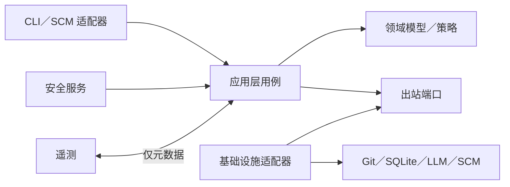

# 自我改进型 AI 代码审查工具详细设计书（共通与总览）

## 文档信息

| 项目 | 内容 |
|---|---|
| 文档类型 | 详细设计书、总体索引 |
| 版本 | 0.1 |
| 状态 | 草案 |
| 创建日期 | 2026-09-12 |
| 上位文档 | `概要设计书.md` |
| 开发规范 | `开发标准.md` |
| 目标读者 | 开发人员、审查人员、维护人员、运维人员 |

## 1. 目的

本文将概要设计分解为可实现的模块、接口、数据、处理流程、异常与测试单元，并定义分阶段开发的共通契约。各功能的专有设计见下列文档。

| 阶段 | 详细设计书 | 完成后具备的能力 |
|---|---|---|
| M1 | `详细设计书_M1_审查基础.md` | 从差异生成经验证的审查发现及测量数据 |
| M2 | `详细设计书_M2_反馈记忆.md` | 将反馈转化为经批准的记忆并评估比较组 B/C |
| M3 | `详细设计书_M3_流水线增强.md` | 动态上下文、自我验证、中断恢复与改进的审查单元划分 |
| M4 | `详细设计书_M4_SCM集成.md` | SCM 拉取请求与审查、反馈的双向集成 |
| M5 | `详细设计书_M5_治理增强.md` | 冲突处理、多项目、可观测性与专项审查角色 |

M1 和 M2 是 MVP 的必需范围。针对 M3 的 FN-10 / FN-12，M1 先实现禁用时的契约，M3 再启用实际功能。

## 2. 设计优先级

发生冲突时，按以下顺序解释。

1. `概要设计书.md`
2. 本文及各阶段详细设计书
3. `开发标准.md`
4. 输入源代码中的补充说明

本文档体系不包含独立的 ADR 或安全策略文档。安全要求由 `概要设计书.md` 第 14 章及本系列详细设计书管理。详细设计须遵守上位文档的契约。确需变更时，先更新概要设计和可追溯性记录。

## 3. 待决事项与阶段门禁

| ID | 影响阶段 | 门禁 | 详细设计中的处理 |
|---|---|---|---|
| TBD-04 引入上下文获取工具的时机 | M1/M3 | M1 启动时 | M1 禁用，计划在 M3 启用 |
| TBD-05 SQLite 迁移工具 | M2 | M2 模式实现前 | 固定 SQL 迁移契约和序号 |
| TBD-06 记忆审批权限 | M2 | M2 审批集成前 | 通过 `ActorAuthorizer` 端口隔离 |
| TBD-07 SCM 优先级 | M4 | 已解决 | 优先支持 GitHub。GitLab 实际适配器留待后续实现 |
| TBD-08 输入源外部发送审批 | M1/M4 | 使用真实输入源之前 | 未获批准的环境仅可使用模拟 LLM 或本地端点 |

门禁尚未解决的功能不得在生产模式中启用。

## 4. 逻辑架构



依赖方向为 `cli / infrastructure → application → domain`。领域层不依赖 Pydantic、SQLite、提供商 SDK 或 CLI 框架。应用层定义端口，由基础设施层实现。

## 5. 物理结构

```text
src/self_improving_code_review/
├── cli/
│   ├── main.py
│   ├── review_commands.py
│   ├── feedback_commands.py
│   ├── memory_commands.py
│   └── evaluation_commands.py
├── application/
│   ├── ports/
│   ├── review/
│   ├── feedback/
│   ├── memory/
│   └── evaluation/
├── domain/
│   ├── common/
│   ├── change/
│   ├── finding/
│   ├── rule/
│   ├── memory/
│   └── evaluation/
├── infrastructure/
│   ├── git/
│   ├── llm/
│   ├── persistence/
│   ├── context_tools/
│   └── scm/
└── security/
    ├── secret_scanner.py
    ├── path_policy.py
    └── prompt_boundary.py
```

测试与上述边界对应，分别存放于 `tests/unit`、`tests/contract`、`tests/integration`、`tests/e2e`、`tests/evaluation`。

审查执行的入口为 `application/review/run_review.py` 中的 `RunReviewUseCase`。
该用例管理同包内各模块的处理顺序。
模块布局见 [M1 详细设计书第 2 章](详细设计书_M1_审查基础.md#2-構成要素とモジュール)，
恢复与并行执行的职责见 [M3 详细设计书第 2 章](详细设计书_M3_流水线增强.md#2-既存実装との対応)。

## 6. 共通领域类型

| 类型 | 主要字段 | 约束 |
|---|---|---|
| `ProjectId` | `value: str` | 1～64 个字符，`[a-z0-9][a-z0-9_-]*` |
| `RunId` | UUIDv4 字符串 | 应用层只生成一次，恢复时沿用 |
| `BundleId` | `run_id + sequence` | 在单次运行内唯一 |
| `FindingId` | `bundle_id + sequence` | 在单次运行内唯一 |
| `NormalizedPath` | POSIX 相对路径 | 拒绝绝对路径、`..` 和 NUL |
| `LineRange` | `start_line, end_line` | 最小值为 1，且 `start <= end` |
| `Severity` | `CRITICAL/HIGH/MEDIUM/LOW` | 与数据库及外部接口双向转换 |
| `RunStatus` | `PENDING/RUNNING/SUCCESS/PARTIAL_SUCCESS/FAILED/BLOCKED` | 只允许按状态转换规则更新 |
| `ValidationStatus` | `VALID/INVALID/NEEDS_CONTEXT` | 按每次验证处理记录原因代码 |

内部枚举采用 `UPPER_SNAKE_CASE`，JSON 和 CLI 使用小写短横线命名或概要设计规定的值。

## 7. 共通端口

```python
class Clock(Protocol):
    def now_utc(self) -> datetime: ...


class IdGenerator(Protocol):
    def new_run_id(self) -> RunId: ...


class UnitOfWork(Protocol):
    runs: RunRepository
    findings: FindingRepository

    def commit(self) -> None: ...
    def rollback(self) -> None: ...


class LlmClient(Protocol):
    def generate_structured(
        self,
        request: LlmRequest,
        output_schema: type[SchemaT],
    ) -> LlmResult[SchemaT]: ...


class SecretScanner(Protocol):
    def scan(self, payload: SourcePayload, profile: ScanProfile) -> ScanResult: ...


class ActorAuthorizer(Protocol):
    def require(self, actor_id: str, permission: Permission) -> None: ...


@dataclass(frozen=True, slots=True)
class RunLeaseIdentity:
    run_id: RunId
    owner: str
    fencing_token: int


class RunLeaseRepository(Protocol):
    def acquire(
        self, run_id: RunId, owner: str, now: datetime, expires_at: datetime
    ) -> RunLeaseIdentity | None: ...
    def heartbeat(
        self, identity: RunLeaseIdentity, now: datetime, expires_at: datetime
    ) -> bool: ...
    def is_owned(self, identity: RunLeaseIdentity, now: datetime) -> bool: ...
    def release(self, identity: RunLeaseIdentity) -> None: ...


class RunLeaseSessionFactory(Protocol): ...


@dataclass(frozen=True, slots=True)
class BackupInspection:
    checks: tuple[tuple[str, bool], ...]
    counts: tuple[tuple[str, int], ...]
    failure_codes: tuple[str, ...]

    @property
    def is_valid(self) -> bool: ...


class BackupInspector(Protocol):
    def inspect(self, database_path: Path, project_id: ProjectId) -> BackupInspection: ...
```

端口的输入与输出均不包含提供商 SDK 类型。将适配器异常转换为 `InfrastructureError` 后返回应用层边界。

## 8. 共通配置

配置优先级为 `CLI 显式值 > 环境变量 > 项目配置 > 默认值`。敏感信息仅允许存放在环境或敏感信息存储中。

```yaml
schema_version: 1
project_id: sample-project
database:
  path: .review/review.db
llm:
  provider: ai_gateway
  base_url: https://aigw.ldjp-ai.link
  model: gpt-5.6-luna
  temperature: null
  timeout_seconds: 60
  max_retries: 2
review:
  mode: rules
  bundle_diff_tokens: 8000
  rule_tokens: 1500
  memory_tokens: 1200
  context_tools_enabled: false
  reflection_enabled: false
  max_workers: 1
  max_context_file_bytes: 1048576
  max_tool_results: 20
  dynamic_context_tokens: 6000
  reflection_tokens: 2000
  max_tool_calls: 5
security:
  allow_external_source: false
  blocked_paths: []
```

生产模式将 `provider` 和 `base_url` 固定为上述值。开发与测试可指定无需外部通信的 `provider: dataset`，并设置仓库内的 `dataset_path`。将 `model` 设为网关公开的固定模型 ID，并拒绝 `latest` 等可变别名。即使指定了 `backend_provider` 与 `model_family`，它们也只用作运维元数据。应用层仅调用网关，无需直接依赖其后端提供商的凭据和 SDK。

启动时验证模式并拒绝未知字段。从环境或敏感信息存储获取 AI 网关凭据，禁止写入配置文件。运行记录应保存配置值、提示词与规则的 SHA-256 哈希。

M3 的 `context_tools_enabled` 与 `reflection_enabled` 默认关闭。
校验 `max_workers` 的范围为 1～8、`max_context_file_bytes` 为 1～2,097,152、
`max_tool_results` 为 1～20。动态上下文获取、自我验证、中断恢复及并行执行的详细契约见
`详细设计书_M3_流水线增强.md`。

### 8.1 LiteLLM 集成契约

| 项目 | 契约 |
|---|---|
| 位置 | 仅限 `infrastructure/llm/` 中的适配器 |
| 调用方式 | LiteLLM Python SDK 的 `litellm.completion` |
| 提供商路由 | 使用 `model=openai/<model>`，将配置中的 AI 网关根 URL 规范化为 `base_url` 使用的 `/v1` 端点 |
| 采样 | 默认采用模型自己的 `temperature`，只有配置明确指定才发送该参数。模型不支持该值时视为请求错误。禁止使用 `drop_params` 隐式删除参数 |
| 库内重试 | `num_retries=0`。禁用 LiteLLM 自身的重试以防双重重试 |
| 应用侧重试 | 仅对连接失败、超时、限流和服务器临时故障执行有上限的指数退避重试 |
| 结构化输出 | 从响应提取单个 JSON 对象，以禁止额外属性的审查模式验证 |
| 使用量 | 记录输入、输出 Token、等待时间和尝试次数，能获取时也记录费用 |
| 依赖边界 | 禁止向领域层与应用层暴露 LiteLLM 或后端提供商的专有类型 |
| 版本管理 | 允许的版本范围以 `pyproject.toml` 为准，实际解析的版本以 `uv.lock` 为唯一依据 |

LiteLLM 的异常在边界转换为项目异常。连接失败、超时、限流和服务临时故障转换为可重试的 `LlmClientError`，响应格式不合法转换为 `InvalidLlmOutputError`，认证失败、请求不合法及其他 API 故障转换为不可重试的 `LlmClientError`。异常消息不得包含凭据、完整提示词或完整响应。

当前安全的组合是 LiteLLM 1.100.4 与 FileLock 4 系列。若更高版本的 LiteLLM 要求
`filelock<4`，则无法同时满足依赖约束。更新前须检查依赖方的兼容性，并验证请求参数、异常、
重试、响应解析和用量统计的契约测试。

`DatasetLlmClient` 仅用于开发及自动化测试。它返回经过验证的固定 JSON 响应，不连接网络。数据集路径限定在仓库内。生产配置禁止使用 `dataset` 提供商。

## 9. 共通异常与退出码

| 异常 | 退出码 | 运行状态 | 重试 |
|---|---:|---|---|
| `InvalidInputError` / `InvalidDiffError` | 1 | `FAILED` | 否 |
| `LlmClientError` | 2 | `PARTIAL_SUCCESS` 或 `FAILED` | 仅临时故障 |
| `InvalidLlmOutputError` | 3 | `PARTIAL_SUCCESS` 或 `FAILED` | 修复 1 次 |
| `PolicyViolationError` / 检测到敏感信息 | 4 | `BLOCKED` | 仅允许覆盖后发起新的运行 |
| 未分类的 `DomainError` / `InfrastructureError` | 5 | `FAILED` | 视原因而定 |

在进程边界将异常转换为退出码，堆栈跟踪只写入调试日志。异常消息不得包含敏感信息、完整输入源或完整提示词。

## 10. 事务与幂等性

将 SQLite 的 M3 审计实现拆分到 `m3_audit_repository.py` 的 `SqliteM3AuditRepository`。
`SqliteUnitOfWork` 传递现有事务所用的同一连接。存储库不创建连接、不提交也不回滚。
保留 SQL、保存顺序、还原顺序和异常转换，数据库模式与已共享的迁移也保持原样。
审查单元结果、审查发现、规则引用和 LLM 调用记录的写入分别拆分到 `bundle_repository.py`、
`finding_repository.py`、`rule_snapshot_repository.py` 和 `llm_call_repository.py`。
使用同一工作单元的连接，保留审查发现的行格式、编号规则、异常及更新与插入的 SQL。
保存结果的还原拆分到 `review_result_repository.py`，测量数据的 JSON 转换拆分到 `review_metrics_codec.py`，
运行及审查发现的行转换拆分到 `review_row_mapper.py`。保留完成、恢复和中断时的状态选择、
SQL 列顺序、排序、已有的非法值拒绝规则及异常。禁止新增补全行为或迁移。
运行创建、恢复和带隔离令牌的最终确认拆分到 `run_repository.py`，现有建表定义拆分到 `review_schema.py`，
初始化及迁移顺序控制拆分到 `sqlite_initialization.py`。`sqlite.py` 负责共享连接及
工作单元的构建、提交和撤销。通过重新导出保留现有的 `sqlite.initialize_database` 导入路径。
SQL 字符串、适用条件、迁移编号、异常与连接设置保持原样。


第 12～15 号已发布迁移作为历史数据库兼容记录继续执行。初始化保留其中的表和数据，
包括历史草稿与审计记录。正确答案数据集仍使用既有的 CLI、存储和归属契约。

- 运行创建、状态更新、审查单元及审查发现的保存按工作单元纳入事务。
- 备份检查在 URI 只读连接中以 `query_only` 打开已还原数据库，禁止初始化、迁移和更新。
- 使用独立于业务工作单元的短时连接获取运行租约、发送心跳和释放租约。
- 更新最终状态时，在同一事务中验证所有者与隔离令牌并释放租约。
- 相同有效幂等键或租约所有权发生冲突时，抛出 `ConcurrencyConflictError`。
- 调用外部 LLM 或 SCM 期间禁止持有数据库事务。
- 调用外部服务前保存运行意图，收到响应后在短事务内写入结果。
- 幂等键以 `operation_type:project_id:source_revision:configuration_hash` 为基础。
- 使用相同键时，已完成的处理返回既有结果，进行中的处理视为冲突。
- 审查的幂等键还包含差异哈希、运行模式、软件包版本、提示词哈希、规则集哈希、敏感信息检查引擎版本和模型。
- `memory` 模式还将运行开始时有效记忆的 ID、版本和内容哈希计算出的数据集哈希纳入幂等键。
  `baseline` 与 `rules` 模式省略该哈希。
- 提示词、规则、包含确定性验证的软件包版本或敏感信息检查器发生变化时，即使差异相同也启动新运行，
  禁止复用旧版本保存的结果。
- 数据库失败时不得返回成功。通过唯一约束防止重试产生重复的审查发现或反馈。

## 11. 共通安全处理

```text
不可信输入源
→ 路径策略
→ 大小与预算检查
→ 严格的敏感信息检查
→ 提示词边界编码
→ LLM 客户端
```

差异及上下文获取工具的输出按 LLM 发送单元检查。将代表检查通过的 `scan_id`、引擎版本及发送内容哈希保存在内存中的 `ScannedPayload` 内。哈希变化后重新检查。禁止在日志或数据库中保存输入源正文及疑似敏感信息的字符串。

## 12. 结构化日志

必填字段包括 `timestamp`、`level`、`event`、`run_id`、`status`、`duration_ms`。适用时添加 `bundle_id`、`finding_id`、`model`、`prompt_version`、Token 数、费用和 `error_code`。

事件示例

- `review_run_started` / `review_run_completed`
- `review_bundle_started` / `review_bundle_failed`
- `llm_call_completed` / `llm_call_failed`
- `secret_scan_blocked`
- `feedback_recorded`
- `memory_status_changed`

## 13. 版本管理

| 对象 | 版本 |
|---|---|
| 数据库 | 迁移序号 |
| 配置 | `schema_version` |
| 提示词 | 文件内 `prompt_version` + 内容哈希 |
| 规则 | Git SHA + 路径 + 内容哈希 + 规则集哈希 |
| 记忆 | `memory_id` + `version` + 快照 ID |
| 处理基础设施 | 软件包版本 + Git 提交 SHA |
| 评估 | 正确答案数据集版本 + 评估配置哈希 |

## 14. 阶段间兼容性

- 后续阶段不得删除现有 JSON 字段或改变其含义。新增字段最初应为可选。
- 数据库通过追加前向迁移演进。禁止修改已共享的迁移。
- `migrations/*.sql` 全部应用后的模式及版本记录须与运行时初始化结果相同，并经契约测试验证。
- M1 先实现 M3 契约，将 `reflection_status` 设为 `REFLECTION_SKIPPED`，上下文不足时设为 `NEEDS_CONTEXT`。
- M2 使用 M1 的审查发现 ID 和运行 ID 作为外键。
- M4 的 SCM ID 与内部 ID 分开管理。提供商变更不得影响领域 ID。

## 15. 功能可追溯性

| 概要功能 | 实现阶段 |
|---|---|
| FN-01～06、FN-08、FN-09、FN-11、FN-13 | M1 |
| FN-03、FN-17 | 在 M1 建立基础，各阶段扩展 |
| FN-07、FN-14～16、FN-18 | M2 |
| FN-05 增强、FN-10、FN-12、会话恢复 | M3 |
| FN-19 | M4 |
| 专项审查角色、冲突处理与归档、多项目、OTel | M5 |

## 16. 共通完成条件

- 领域单元测试、适配器契约测试和主要流程的集成测试全部通过。
- Ruff、mypy、整体和差异覆盖率及安全门禁全部通过。
- 涉及外部发送输入源的测试仅使用模拟输入源或经批准的测试数据。
- 可用运行 ID 追溯版本、规则、记忆、模型和测量数据。
- 故障时禁止输出敏感信息，并返回稳定的状态及退出码。
